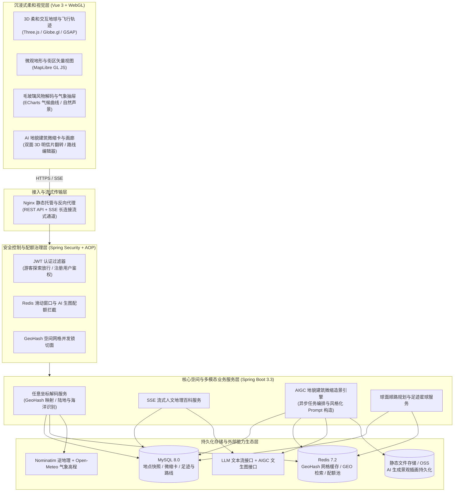
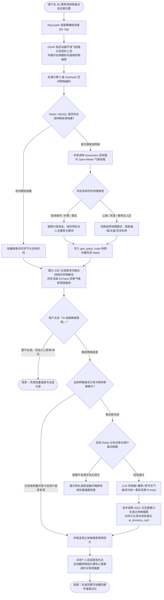
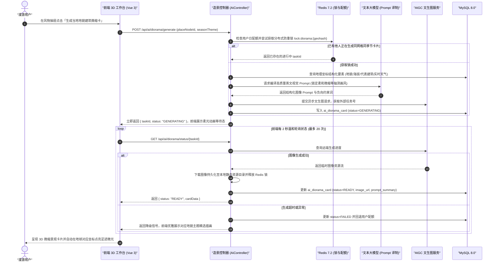
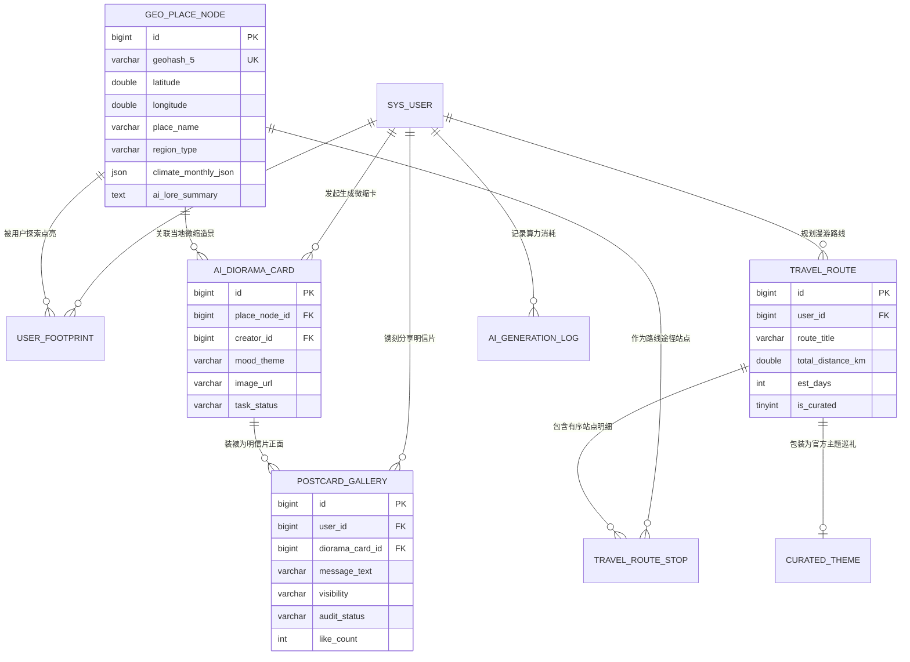

# 《课程设计选题设计文档》

| 项目条目 | 基本信息 |
| :--- | :--- |
| **课题名称** | **WanderSphere（漫游星球）—— 基于 3D 交互地球与多模态 AI 的全球任意坐标深度风物探索与智能旅行地图平台** |
| **课题副标题** | 融合柔和三维地球渲染、地理气象感知与 AIGC 地貌建筑微缩景观生成的沉浸式漫游系统 |
| **完成形式** | 个人独立完成（计划开发周期：5 周） |
| **核心技术栈** | Vue 3 + Three.js / Globe.gl + MapLibre GL + GSAP + Element Plus + ECharts + Spring Boot 3 + MyBatis-Plus + MySQL 8.0 + Redis 7.2 |
| **代码仓库地址** | https://github.com/Jiangsirui/web-course-design |
| **申报人姓名** | 蒋思睿 |
| **学号** | 2024337621116 |
| **专业班级** | 24软件工程1班 |

---

## 一、课题说明

### 1.1 选题背景

随着数字生活节奏的加快与跨文化交流的普及，“在线看世界、沉浸式云漫游、个性化深度自由行”正成为当代大众高频的精神文化与出行需求。然而，回顾现有的地图工具与旅游内容平台，普遍存在明显的体验断层与视觉审美疲劳：

1. **传统导航地图“重工具、轻人文”，视觉冰冷杂乱**：主流电子地图（如高德、Google Maps）高度聚焦路径规划与生活服务 POI 堆叠，界面充斥高饱和度商业图标与道路网线，用户点击一片陌生的高原湖泊、峡湾海岸或小众古城时，只能看到干瘪的经纬度和地名，无法获得关于当地自然成因、气候质感与人文建筑脉络的深度解读。
2. **传统旅游攻略平台“重打卡、轻探索”，同质化严重**：主流游记社区的推荐逻辑受限于商业投放与网红打卡聚集效应，内容高度集中于少数热门景区；对于地球表面广阔的小众村落、冷门海岛、荒漠绿洲乃至无人自然奇观，用户既难以检索到成体系的深度风物介绍，也缺少统一、精致且治愈的视觉呈现形式。
3. **现有 WebGIS 大屏系统多为“暗黑科幻风”，缺乏柔和舒适的日常陪伴感**：目前市面上常见的 3D 地球演示项目大多模仿军事监控或金融大屏的深黑刺眼高对比度样式，长时间浏览极易引发视觉疲劳，与“旅行探索、松弛治愈”的情感基调格格不入。

针对上述现状，本课题拟设计并实现 **WanderSphere（漫游星球）—— 全球任意坐标深度风物探索与智能旅行地图平台**。项目以“**柔光纸感美学 + 沉浸式 3D 地球交互 + 多模态 AIGC 风物造景**”为核心理念，让用户能够用鼠标或指尖温柔转动一颗会呼吸的地球，随心轻点全球任意一寸经纬度，即可平滑拉近视野、实时感知当地天光气候与人文地理故事，并借助多模态 AI 即时生成一张属于该坐标的「**当地特色地貌与代表建筑立体微缩景观卡**」，将地理探索转化为一场兼具美学享受与知识温度的数字漫游体验。

### 1.2 目标用户与使用场景

#### （1）目标用户群体
系统面向社会大众与泛旅行兴趣人群，主要服务以下三类核心用户：
- **旅行爱好者与自由行规划者**：渴望发掘冷门秘境与深度文化线路，希望在出发前通过 3D 地形与气候趋势直观评估目的地气质，并将心仪坐标顺路串联为多日慢游计划。
- **地理人文探索者与治愈系“云漫游”用户**：喜欢在工作学习间隙通过屏幕“看世界”，通过漫无目的地点击地球角落、聆听自然声景、收藏 AI 绘制的地貌建筑明信片来缓解日常焦虑并拓展世界认知。
- **平台内容策展管理员（运营端）**：负责维护全球优质探索主题路线（如“世界木构古建巡礼”“环太平洋火山温泉线”）、审核精选用户投稿明信片画廊以及监控多模态 AI 算力调用健康度。

#### （2）典型使用场景
- **场景一：指尖轻点任意坐标，无缝俯冲解码全球风物**  
  用户在暖柔晨曦色调的 3D 地球上随意点击一处坐标（例如挪威罗弗敦群岛的一处峡湾渔村或云南横断山脉的一座藏族村寨），镜头借助 GSAP 阻尼物理缓动平滑俯冲，渐变为精致矢量地形视图；右侧毛玻璃轻浮抽屉徐徐展开，同步呈现当前当地时间、实时天气与海拔、四季气候舒适度曲线以及由大模型流式娓娓道来的地貌成因、民俗风物与冷知识。
- **场景二：AI 一键绘就“当地特色地貌与代表建筑”立体微缩景观卡**  
  面对陌生角落缺乏优质实拍图或摄影画风杂乱的问题，用户点击「AI 绘就风物造景」按钮，后端自动将当地真实地形地貌（如喀斯特峰林、冰川峡湾、红砂岩峡谷）、实时天气季节与标志性地域建筑风格（如干栏式吊脚楼、北欧木质尖顶屋、土坯夯土碉楼）注入结构化视觉提示词，生成一张统一柔彩微缩立体模型（Isometric Diorama）风格的精美景观插画卡；轻点卡片可优雅翻转，在背面镌刻旅途感悟与心情邮戳。
- **场景三：「随心漫游（盲盒跳伞）」与自然声景伴游**  
  不知道去哪儿时，点击顶部的「随心飞跃」按钮，系统在地球表面划出一道柔和的发光弧线，随机空降到一个冷门却充满故事的世界角落（如法罗群岛草顶屋或摩洛哥蓝白山城），同时依据当地地貌自动匹配海浪、山风或林间细雨声景，带来沉浸式云端放松体验。
- **场景四：多坐标智能顺路串联，点亮个人“足迹星球”**  
  浏览过程中，用户可将多个心仪目的地加入「漫游心愿单」，系统基于球面地理距离自动优化游览顺序并在 3D 地球上绘制流畅的弧线航迹；每一次深度探索与生成卡片都会在用户的专属地球上点亮一枚温润微光坐标点，沉淀为独一无二的个人旅行记忆画廊。

### 1.3 拟解决的核心问题

1. **解决“地图无温度、攻略缺广度”的体验割裂问题**：打破行政区划与热门景点白名单限制，让地球表面的每一处陆地、岛屿乃至海洋都能响应探索请求，实现“任意坐标可点击、点击必有深度回响”。
2. **解决“全球小众角落视觉资料匮乏且风格割裂”的问题**：借助真实地理要素驱动的 AIGC 图像生成机制，为全网缺乏高质量美图的冷门地理坐标提供画风高度统一、精致柔和的地貌建筑立体微缩视觉呈现。
3. **解决“信息过载与刺眼界面破坏探索心流”的问题**：摒弃高饱和霓虹大屏与密集控件堆砌，通过低饱和暖白/鼠尾草绿/陶土橘莫兰迪配色体系与渐进式毛玻璃抽屉，在呈现丰富地理气象与人文数据的同时保持界面呼吸感与舒适度。
4. **解决“全球无限坐标探索与 AI 推理延迟及成本过高”的矛盾**：构建基于 GeoHash 空间网格的共享缓存池与预置种子地标库，大幅降低高频热门坐标的重复调用开销，确保秒级交互响应。

### 1.4 特色与创新点

1. **温润治愈系美学体系与“宏观 3D 地球—微观地形”无级丝滑衔接**  
   不同于千篇一律的深黑科幻风 WebGIS 作品，本系统专为旅行审美定制了柔和淡雅的日照散射大气层、真实昼夜晨昏过渡光影与莫兰迪手绘质感地形贴图；在用户拉近缩放倍率至城市/山谷尺度时，自动实现 `Three.js` 3D 球体到 `MapLibre GL` 柔和矢量 3D 建筑/等高线地形的无感过渡。
2. **真实地理属性驱动的 AIGC“特色地貌 + 代表建筑”微缩景观卡**  
   AI 生图并非盲目自由发挥，而是严格绑定当前坐标的**海拔、植被带、实时气象季节、主要地貌类型与历史建筑形制**等客观结构化参数，再经统一柔和插画风提示词工程约束，产出的微缩景观卡兼具地理真实性与高度一致的艺术质感。
3. **基于 Redis GeoHash 的全球空间网格协同缓存引擎**  
   全球经纬度是连续无限的，直接按精确小数缓存命中率极低。系统采用 `5 级 GeoHash`（约 `4.9km × 4.9km` 空间网格）进行区域聚合索引：同一网格内既复用了先驱探索者沉淀的深度风物解析与共享微缩景观，又保留了实时天气的独立轻量刷新，兼顾探索独特性与算力经济性。
4. **全覆盖零死角体验与动态双面明信片叙事**  
   针对用户误点或刻意点击广阔公海、撒哈拉腹地或极地冰盖的情况，系统不抛出“未找到地点”的冷硬报错，而是优雅切换为**「自然地理与洋流科普模式」**，讲述大洋环流、板块地质演化与生态奇观；所有生成的景观卡均支持 3D 翻面写信与邮戳印记，构成富有人文仪式感的数字明信片画廊。

---

## 二、项目框架

### 2.1 技术选型及理由

本项目采用现代前后端分离全栈架构，在保障企业级工程规范性与并发可靠性的基础上，重点引入成熟稳定的 WebGL 3D 渲染与多模态 AI 流式编排技术栈：

| 技术分层 | 选型方案 | 选型核心理由 |
| :--- | :--- | :--- |
| **前端核心框架** | `Vue 3.4+` + `Vite 5` | 使用 Composition API（`<script setup>`）优雅解耦复杂的三维相机控制、状态同步与异步流式渲染逻辑；Vite 提供毫秒级热重载，加速单人开发调试。 |
| **3D 地球与微观地图** | `Three.js` + `Globe.gl` + `MapLibre GL JS` | `Three.js` 与 `Globe.gl` 负责渲染带大气散射辉光、昼夜晨昏线及柔和弧线航迹的 3D 交互地球；`MapLibre GL` 负责放大至微观尺度后的矢量等高线与柔和 3D 建筑轮廓接管。 |
| **UI 体系与动效** | `Element Plus` + `Tailwind CSS` + `GSAP` | 通过 CSS 变量深度定制 Element Plus 为暖白浅沙、低饱和柔和主题；Tailwind 快速构建高雅磨砂毛玻璃（Backdrop Blur）浮层；`GSAP` 驱动相机飞行阻尼与明信片 3D 翻转丝滑物理动画。 |
| **气候数据可视化** | `Apache ECharts 5` | 流畅绘制坐标点月度气温降水舒适度双轴曲线、旅行指数五维雷达图及个人足迹大洲分布玫瑰图，视觉风格高度贴合柔和主题。 |
| **前端状态与请求** | `Pinia` + `Vue Router 4` + `Axios` / `Fetch SSE` | Pinia 集中管理当前选中坐标、足迹点亮集合及漫游路线草稿；原生 `Fetch` 配合 ReadableStream 优雅接收后端大模型打字机流式（SSE）解说。 |
| **后端核心框架** | `Spring Boot 3.3`（`JDK 17 LTS`） | 自动装配简洁可靠，原生完善支持 `WebClient` 异步非阻塞调用外部地理/气象 API 及 `SseEmitter` 流式推送，非常适合多源聚合网关服务。 |
| **持久层与 ORM** | `MyBatis-Plus 3.5` | 大幅减少基础实体 CRUD 样板代码，配合 XML 自定义查询高效处理足迹统计、主题画廊分页及路线站点排序落库。 |
| **安全认证体系** | `Spring Security 6` + `JWT` | 实现无状态令牌认证，同时支持**“游客即开即用轻体验 + 登录用户持久点亮足迹与高频 AI 配额”**的分级放行策略。 |
| **关系与空间缓存库** | `MySQL 8.0` + `Redis 7.2` | MySQL 稳定持久化用户、探索地点快照、微缩景观卡及旅行路线；Redis 利用 `GEO` 索引、`GeoHash` 网格缓存与分布锁防止并发重复生图。 |
| **地理与气象开放生态** | `Nominatim (OSM)` + `Open-Meteo API` | 零商业授权门槛的全球逆地理编码（经纬度转国家/地名/行政区）与全球高程/实时天气/历史气候月均值查询接口。 |
| **多模态 AI 服务** | `DeepSeek / 通义千问 (SSE)` + `通义万相 / Kolors 文生图` | 文本大模型负责结构化地理风物深度解读与视觉 Prompt 转译；文生图大模型负责生成高质量 Isometric 微缩地貌建筑插画。 |
| **接口契约与调试** | `Knife4j`（SpringDoc OpenAPI 3） | 自动生成直观在线 API 文档，方便单人开发期间快速验证接口入参校验与流式/异步状态轮询逻辑。 |

### 2.2 总体架构

系统总体按**沉浸式柔和视觉层、接入与流式传输层、安全与配额限流层、核心空间与多模态业务服务层、数据存储与外部生态层**五层架构设计：



### 2.3 前后端工程结构

项目在同一 Git 仓库下采用清晰的独立工程目录拆分（`wandersphere-frontend` 与 `wandersphere-backend`），便于前后端协同开发与后续容器化部署：

```text
web-course-design/
├── 课程设计选题设计文档.md                  # 课程设计选题设计申报文档
├── README.md                              # 仓库展示说明与项目导航
├── sql/
│   ├── init_schema.sql                    # 核心业务建表 DDL（含经纬度与 GeoHash 索引）
│   └── seed_landmarks.sql                 # 全球 30+ 精选地标与预设微缩风物卡演示种子数据
├── wandersphere-frontend/                 # 前端工程 (Vue 3 + Vite + Three.js + Element Plus)
│   ├── public/
│   │   ├── textures/                      # 柔和定制地球反照率贴图、高度法线贴图与云层纹理
│   │   └── audio/                         # 轻量循环环境音（海浪、山风、细雨、古刹风铃）
│   ├── src/
│   │   ├── api/                           # 封装坐标解码、SSE 流式风物、微缩卡生图、路线与画廊接口
│   │   ├── assets/                        # 莫兰迪柔彩主题样式变量、自定义邮戳 SVG 图标
│   │   ├── components/
│   │   │   ├── globe/                     # 3D 交互地球画布、昼夜光照控制器、弧线航迹与呼吸光点组件
│   │   │   ├── map/                       # 放大后的 MapLibre 柔和矢量地形衔接组件
│   │   │   ├── drawer/                    # 渐进式毛玻璃风物百科抽屉与气象实时胶囊
│   │   │   ├── diorama/                   # AI 地貌建筑微缩卡生成等待态、3D 双面翻转明信片组件
│   │   │   ├── charts/                    # ECharts 四季舒适度折线图与足迹统计玫瑰图
│   │   │   └── soundscape/                # 环境声景自适应微调浮窗组件
│   │   ├── composables/                   # 组合式逻辑 (useGlobeCamera, useSseStream, useAudioAmbient)
│   │   ├── router/                        # 路由配置（漫游地球主页、主题巡礼、明信片画廊、个人足迹馆）
│   │   ├── stores/                        # Pinia 状态仓 (exploreStore, routeDraftStore, userStore)
│   │   ├── views/
│   │   │   ├── ExploreGlobeView.vue       # 全屏沉浸式 3D 地球探索主界面
│   │   │   ├── GalleryWallView.vue        # 精选风物明信片与全球微缩景观灵感画廊
│   │   │   ├── RoutePlannerView.vue       # 心愿坐标顺路串联与慢游行程编辑器
│   │   │   ├── FootprintAtlasView.vue     # 个人点亮“足迹星球”与旅途记忆簿
│   │   │   └── AdminCurateView.vue        # 官方主题线路策展与内容审核后台
│   │   ├── App.vue
│   │   └── main.js
│   ├── index.html
│   └── package.json
└── wandersphere-backend/                  # 后端工程 (Spring Boot 3 + MyBatis-Plus + Redis)
    ├── src/main/java/com/wandersphere/
    │   ├── WanderSphereApplication.java   # 应用启动类
    │   ├── common/                        # 统一响应体 Result<T>、全局异常处理、GeoHash 工具与距离计算器
    │   ├── config/                        # Security、Redis、Async 异步线程池、WebClient、静态资源映射配置
    │   ├── security/                      # JWT 解析器、游客/登录分级拦截与限流切面
    │   ├── geo/                           # 外部地理逆编码适配器 (Nominatim) 与气象高程客户端 (Open-Meteo)
    │   ├── ai/
    │   │   ├── llm/                       # 大模型 SSE 流式地理风物解说与提示词转译服务
    │   │   └── diorama/                   # AIGC 文生图异步任务提交、状态轮询与图片本地持久化服务
    │   ├── controller/                    # GeoController, AiController, RouteController, GalleryController, AdminController
    │   ├── service/                       # 核心业务编排实现层
    │   ├── mapper/                        # MyBatis-Plus Mapper 接口
    │   └── model/
    │       ├── entity/                    # 数据库实体类
    │       ├── dto/                       # 请求入参校验模型
    │       └── vo/                        # 视图聚合响应对象
    ├── src/main/resources/
    │   ├── mapper/                        # 空间筛选与排行统计 XML
    │   └── application.yml                # 服务端口、数据库、Redis、AI 与气象服务配置
    └── pom.xml
```

### 2.4 开发与运行环境

| 环境类别 | 软件 / 组件名称 | 版本与规格说明 |
| :--- | :--- | :--- |
| **开发主机环境** | 操作系统 | Windows 11 64-bit |
| **编译与运行时** | Java 运行环境 / 前端运行时 | OpenJDK 17 LTS / Node.js 20.x LTS |
| **构建与包管理** | 后端构建 / 前端包管理 | Apache Maven 3.9+ / pnpm 9.x（或 npm 10.x） |
| **数据存储中间件** | 关系数据库 / 空间缓存 | MySQL 8.0.x（字符集 `utf8mb4`） / Redis 7.2.x |
| **开发调试工具** | IDE 与辅助工具 | Google Antigravity、IntelliJ IDEA 2024.x、Knife4j、Navicat、Git 2.50+ |
| **运行与部署要求** | 服务端部署环境 | 支持本地前后端联调，亦可打包为 JAR + Nginx 静态托管运行于 Linux (Ubuntu 22.04) |
| **客户端图形要求** | 现代浏览器与图形加速 | Chrome 120+ / Edge 120+ / Safari 17+，需开启硬件加速以支持 WebGL 2.0 渲染 |

---

## 三、功能模块设计

### 3.1 模块划分

系统以“柔和探索地球 → 深度解码当地风物 → AI 造景可视化收藏 → 路线串联点亮足迹”为体验主轴，划分为 **6 大核心功能模块**：

```mermaid
flowchart TD
    Root["WanderSphere 全球智能探索与旅行地图平台"]

    Root --> M1["1. 3D 柔和地球与全尺度漫游模块"]
    Root --> M2["2. 任意坐标地理气象解码模块"]
    Root --> M3["3. AIGC 地貌建筑微缩卡与人文模块"]
    Root --> M4["4. 智能路线串联与主题巡礼模块"]
    Root --> M5["5. 足迹星球与明信片画廊模块"]
    Root --> M6["6. 认证配额与后台策展管理模块"]

    M1 --> M1_1["晨昏线与柔光大气 3D 地球"]
    M1 --> M1_2["GSAP 阻尼飞行与盲盒跳伞"]
    M1 --> M1_3["宏观地球到微观地形无感衔接"]
    M1 --> M1_4["地貌自适应环境声景陪伴"]

    M2 --> M2_1["任意经纬度拾取与 GeoHash 聚合"]
    M2 --> M2_2["行政地名解析与海洋无人区识别"]
    M2 --> M2_3["实时天气、海拔与四季舒适度曲线"]

    M3 --> M3_1["SSE 流式风物历史与建筑脉络解说"]
    M3 --> M3_2["真实地理驱动的微缩景观插画生成"]
    M3 --> M3_3["冷门地点精选插画兜底与风格锁定"]

    M4 --> M4_1["多心愿坐标球面顺路排序优化"]
    M4 --> M4_2["地球航线弧线绘制与日程微调"]
    M4 --> M4_3["官方精选主题世界巡礼专线"]

    M5 --> M5_1["探索点亮个人足迹星球微光标记"]
    M5 --> M5_2["3D 双面翻转明信片寄语与邮戳"]
    M5 --> M5_3["公共风物灵感画廊与按洲筛选"]

    M6 --> M6_1["游客体验与登录分级配额限流"]
    M6 --> M6_2["主题线路编辑与画廊精选审核"]
    M6 --> M6_3["全球热门坐标与生图算力监控"]
```



### 3.2 功能清单

结合个人 5 周开发节奏，功能清单按 **P0（核心必做闭环）** 与 **P1（视觉加分与沉浸体验增强）** 明确边界：

| 所属模块 | 功能名称 | 适用角色 | 优先级 | 功能详细说明 |
| :--- | :--- | :--- | :---: | :--- |
| **3D 柔和地球漫游** | 晨昏线柔光 3D 地球渲染 | 全体用户 | P0 | 基于 Three.js 渲染莫兰迪柔彩地形、半透明暖白大气辉光与真实太阳照射晨昏线。 |
| **3D 柔和地球漫游** | 任意坐标拾取与平滑飞跃 | 全体用户 | P0 | 鼠标点击地球任意表面拾取精准经纬度，触发 GSAP 阻尼飞行相机自动对准目标并展示涟漪光标。 |
| **3D 柔和地球漫游** | 宏观—微观地图尺度衔接 | 全体用户 | P1 | 相机高度拉近至区域级阈值时平滑淡入 MapLibre 柔和矢量地形、水系与 3D 建筑轮廓。 |
| **3D 柔和地球漫游** | 「随心漫游」盲盒空降 | 全体用户 | P0 | 一键从全球冷门奇观坐标库中抽取目的地，划出柔和光弧飞往未知角落。 |
| **3D 柔和地球漫游** | 氛围自然声景伴游 | 全体用户 | P1 | 根据目标地的海岛、山地、森林或古城属性自动轻音播放可开关的自然环境白噪音。 |
| **地理气象解码** | 逆地理与海洋无人区识别 | 全体用户 | P0 | 自动识别陆地行政区划或大洋/极地归属；遇到公海或无人区自动切换自然地理科普视角，绝不报错空窗。 |
| **地理气象解码** | 实时气象、海拔与气候曲线 | 全体用户 | P0 | 聚合目标地实时温度、风速、海拔、当地时间，并以 ECharts 渲染 12 个月气温降水与最佳旅行窗口曲线。 |
| **地理气象解码** | GeoHash 空间网格共享缓存 | 系统自动 | P0 | 将相近点击聚拢至 5 级空间网格，复用已解析的地理静态档案并按 30 分钟粒度异步刷新实时天气。 |
| **AIGC 风物造景** | SSE 流式风物人文解说 | 全体用户 | P0 | 结合地理气象上下文，流式生成「地形地貌成因」「特色民居建筑」「在地生活切片」「冷知识彩蛋」四段式散文解说。 |
| **AIGC 风物造景** | AI 特色地貌与建筑微缩景观生成 | 全体用户 | P0 | 自动将地形、季节天气与本土建筑元素编译为柔和微缩景观（Isometric Diorama）生图指令，异步渲染精致立绘卡片。 |
| **AIGC 风物造景** | 本地风物灵感问答追问 | 登录用户 | P1 | 支持在风物抽屉底部就当前坐标继续追问（如“这里最适合发呆的季节与本地饮食文化”）。 |
| **路线与主题巡礼** | 心愿坐标收藏与球面顺路规划 | 登录用户 | P0 | 收集多个探索过的坐标点，采用球面最近邻算法一键排序串联最短漫游航线并在地球表面绘制弧线。 |
| **路线与主题巡礼** | 官方世界主题巡礼线路 | 全体用户 | P0 | 预置多条高审美策展专线（如“丝绸之路绿洲古城”“北欧峡湾灯塔线”），支持一键逐站导览播放。 |
| **足迹与画廊** | 个人“足迹星球”点亮与图鉴 | 登录用户 | P0 | 探索并生成卡片后在专属地球上点亮温暖微光坐标点，统计已解锁大洲覆盖率与地貌图鉴。 |
| **足迹与画廊** | 双面 3D 翻转风物明信片 | 登录用户 | P0 | 将 AI 微缩景观卡翻转至背面，写下此刻心情寄语并加盖经纬度与实时天气主题邮戳，支持高清海报保存。 |
| **足迹与画廊** | 公共风物灵感画廊墙 | 全体用户 | P1 | 瀑布流展示社区用户公开分享的精选地理明信片，支持按大洲、地貌类型筛选并一键“飞往该坐标”。 |
| **管理与配额治理** | 游客/登录用户分级配额治理 | 全体用户 | P0 | 游客支持无门槛浏览已缓存地点与每日轻量体验；登录用户享受完整足迹保存与独立每日 AI 造景配额。 |
| **管理与配额治理** | 策展管理与画廊审核后台 | 管理员 | P0 | 维护官方推荐主题路线、精选种子地标插画兜底库、审核用户投稿明信片及查看 AI 调用开销趋势。 |

### 3.3 核心业务流程图

#### （1）全球任意坐标点击探索、AI 风物解码与微缩造景全流程



#### （2）异步生成当地特色地貌与建筑微缩景观卡时序图



### 3.4 主要用例说明

#### 用例一：全球任意经纬度点击拾取与全覆盖风物解码（`UC-01`）

| 用例要素 | 详细规约说明 |
| :--- | :--- |
| **用例编号与名称** | `UC-01`：全球任意经纬度点击拾取与全覆盖风物解码 |
| **主要参与者** | 漫游探索用户（含未登录游客与注册用户） |
| **前置条件** | 浏览器支持 WebGL 2.0，3D 地球主场景已完成纹理与光照初始化。 |
| **基本事件流** | 1. 用户旋转并缩放 3D 地球，在地球表面任意位置单击。<br/>2. 前端通过 Raycaster 计算射线与球面交点并反算十进制度数 `(lat, lng)`，在点击处绽放柔和脉冲圆环，同时使用 GSAP 将相机平滑移动至目标上空视角。<br/>3. 前端携带坐标向后端发起解码请求；后端将其编码为 5 级 `GeoHash`（精度约 4.9km），优先检索 Redis 与 MySQL。<br/>4. 若未命中缓存，后端并行调用 `Nominatim` 逆地理编码与 `Open-Meteo` 获取实时温度、风力、海拔及 12 个月历史气候均值。<br/>5. 后端整理结构化地理画像后返回前端；前端随即展开右侧半透明毛玻璃抽屉，渲染气象胶囊与 ECharts 四季舒适度折线图，并同步开启 SSE 流式风物人文解说。 |
| **备选 / 异常事件流** | - **4a. 点击大洋深处或极地无人区**：逆地理接口未返回市县级行政区时，后端自动匹配内置《全球海域与主要自然地理分区多边形表》，输出大洋环流、海沟地质或极昼极夜生态科普，保证不出现错误弹窗。<br/>- **4b. 外部天气/逆地理超时**：启用 2.5 秒熔断超时，若外部源暂不可用则先依据经纬度气候带估算基础数据并提示部分实时气象稍后重试。 |
| **后置条件** | 该网格地理实体沉淀至 `geo_place_node` 表，用户可在抽屉中继续触发 AI 微缩造景或加入心愿路线。 |

#### 用例二：AI 驱动的当地特色地貌与建筑微缩景观卡生成（`UC-02`）

| 用例要素 | 详细规约说明 |
| :--- | :--- |
| **用例编号与名称** | `UC-02`：AI 驱动的当地特色地貌与建筑微缩景观卡生成 |
| **主要参与者** | 登录探索用户、文本与文生图大模型服务 |
| **前置条件** | 用户已通过 `UC-01` 解码目标坐标，且当日剩余 AIGC 造景配额大于 0。 |
| **基本事件流** | 1. 用户在风物抽屉点击「AI 绘就微缩景观」，可选择偏好画面氛围（如「晴日暖阳」「暮色微光」「雪落静谧」或随系统实时天气）。<br/>2. 后端检查该 GeoHash 网格及氛围标签下是否已有社区共享微缩卡；若已有，优先毫秒级展示并允许用户决定是否重新定制绘制。<br/>3. 若触发新生成，后端先调用文本大模型提取该地最具代表性的自然地貌与乡土建筑要素，将其注入预设的 **Soft Isometric Miniature Diorama（柔和等轴测微缩景观）** 模板提示词与负向去杂词。<br/>4. 后端异步调用文生图 API 创建任务并返回 `taskId`；生成完成后下载图片转存至平台静态目录，避免外链过期失效。<br/>5. 前端展示流畅渐显的微缩风物景观卡，并在用户的地球上永久点亮该坐标点的足迹微光。 |
| **备选 / 异常事件流** | - **3a. 敏感词或生成失败退回**：若文生图接口因网络或内容安全规则拦截返回失败，后端自动释放并发锁并返还本次用户扣减配额，同时前端平滑降级呈现预置同地貌类型的精品手绘矢量卡面。 |
| **后置条件** | 新增记录落库 `ai_diorama_card` 与 `user_footprint`，可进一步编辑为双面明信片。 |

#### 用例三：多心愿坐标球面顺路串联与漫游路线规划（`UC-03`）

| 用例要素 | 详细规约说明 |
| :--- | :--- |
| **用例编号与名称** | `UC-03`：多心愿坐标球面顺路串联与漫游路线规划 |
| **主要参与者** | 自由行规划用户 |
| **前置条件** | 用户已在探索过程中向「漫游心愿篮」添加了至少 2 个地理坐标点。 |
| **基本事件流** | 1. 用户打开路线编辑器，指定本次探索的起点坐标与预计旅行总天数。<br/>2. 点击「一键顺路串联」，后端提取各站点的经纬度，依据 **Haversine 球面大圆距离公式**（见表后公式）计算站间实际地球弧长距离。<br/>3. 后端运行最近邻贪心算法结合 2-Opt 局部交叉消除优化站点访问序列，并估算每段跨度与建议停留天数。<br/>4. 前端在 3D 地球表面按优化顺序依次绘制柔和的二次贝塞尔发光飞行弧线，支持用户拖拽微调先后顺序并保存路线。 |
| **备选 / 异常事件流** | - **3a. 跨洲远距离提醒**：若相邻两站直线球面距离超过 3000 公里且跨越多个时区，系统在日程卡片旁标注温馨的“长途跨洲飞行与倒时差提示”。 |
| **后置条件** | 路线主体与明细站点落库 `travel_route` 与 `travel_route_stop`，支持后续一键回放沿途巡礼动画。 |

其中，任意两站点坐标 `(φ₁, λ₁)` 与 `(φ₂, λ₂)` 之间的球面大圆距离 `d`（地球平均半径 `R = 6371 km`）计算公式如下：

$$
d = 2R \arcsin\left(\sqrt{\sin^2\left(\frac{\phi_2 - \phi_1}{2}\right) + \cos(\phi_1)\cos(\phi_2)\sin^2\left(\frac{\lambda_2 - \lambda_1}{2}\right)}\right)
$$

#### 用例四：双面风物明信片寄语镌刻与画廊分享（`UC-04`）

| 用例要素 | 详细规约说明 |
| :--- | :--- |
| **用例编号与名称** | `UC-04`：双面风物明信片寄语镌刻与画廊分享 |
| **主要参与者** | 登录探索用户、平台运营审核员（公开画廊场景） |
| **前置条件** | 用户已点亮某坐标并拥有关联的 AI 微缩景观卡。 |
| **基本事件流** | 1. 用户在足迹档案页或风物抽屉点击「制作双面明信片」，前端通过 CSS 3D `preserve-3d` 与 GSAP 将微缩景观卡翻转至素雅信纸背面。<br/>2. 系统自动在明信片右上角印制包含目标地经纬度、海拔及探索当天实时温度天气图标的复古线性邮戳。<br/>3. 用户在横线信笺区输入感悟寄语（支持“向世界发送一段简短问候”AI 润色辅助），选择「仅个人珍藏」或「投稿至公共风物画廊」。<br/>4. 提交保存后，支持在浏览器内通过 Canvas 将正面插画与背面寄语合成导出为高分辨率双拼纪念图片。 |
| **备选 / 异常事件流** | - **3a. 公共投稿合规审核**：选择公开分享至画廊的明信片默认进入轻量待审队列（同步执行基础敏感词过滤），管理员在后台审核通过后正式陈列于公共灵感画廊墙。 |
| **后置条件** | 明信片记录写入 `postcard_gallery`，丰富社区全球探索氛围。 |

---

## 四、数据库选型

### 4.1 存储组件选型与理由

本项目采用 **MySQL 8.0（关系型主数据库） + Redis 7.2（空间索引与高速缓存组件）** 的双引擎持久化方案：

1. **关系型主数据库选用 MySQL 8.0（InnoDB 引擎）的理由**：
   - **严密实体关联与事务一致性**：探索地标节点、AI 微缩卡、个人足迹记录、双面明信片以及多站漫游路线之间具备清晰的外键归属与一对多关联，InnoDB 事务机制保障路线重排保存与配额扣减回退的原子性。
   - **原生 `JSON` 与空间扩展支持**：气候 12 个月历史统计序列、AI 编译后的结构化标签与游记邮戳元数据直接存储为二进制 `JSON` 字段，兼顾结构化查询性能与半结构化扩展灵活性。
   - **成熟稳定、生态完善**：与 `Spring Boot 3 + MyBatis-Plus` 深度兼容，配合复合索引（如 `uk_geohash`、`idx_user_footprint`）即可高速支撑百万级坐标快照检索。
2. **内存缓存与空间中间件选用 Redis 7.2 的理由**：
   - **GeoHash 电网级空间索引与 `GEO` 半径查询**：利用 Redis 原生 `GEOADD / GEORADIUS` 指令，可在 1 毫秒内快速判断用户点击点周围 5 公里内是否已存在高质量探索节点，实现“近似坐标秒级复用”。
   - **防并发重复生图分布式锁**：针对热门地标（如巴黎埃菲尔铁塔、富士山）可能同时被多名用户点击生成微缩卡的场景，采用 `SET lock:diorama:{geohash} NX PX` 锁合并相同生图请求，极大节约多模态算力支出。
   - **精确每日 AI 配额滑动控制**：基于 `INCR` 与当日自然零点过期的键值对，轻量控制游客与登录用户的文生图每日可用额度。

### 4.2 同类数据库对比分析

| 对比维度 | **MySQL 8.0 + Redis 7.2（本项目选用）** | PostgreSQL + PostGIS | MongoDB（文档数据库） | SQLite（嵌入式数据库） |
| :--- | :--- | :--- | :--- | :--- |
| **事务与常规关系检索** | 极佳，ACID 完备，MyBatis-Plus 零样板开发效率极高 | 极佳，复杂地理几何空间分析极其专业 | 多文档联合事务弱，复杂连表查询繁琐 | 仅单机文件锁，并发请求下易报数据库锁定错误 |
| **空间邻近检索与缓存** | 借助 Redis `GEO` 与 `GeoHash` 索引完美满足半径聚合需求 | PostGIS 原生多边形几何计算最强大，但本课设无需重型测绘计算 | 原生支持 `2dsphere` 索引，但缺少关系完整性约束 | 缺乏原生内存空间索引与并发缓存 |
| **多模态算力锁与限流** | Redis 原子计数与超时锁生态无可替代 | 需额外搭配 Redis | 需额外搭配 Redis | 不具备跨进程分布式限流与锁能力 |
| **单人部署与答辩兼容性** | 安装普及率最高，Navicat/Docker 开箱即用，答辩演示稳定性最佳 | 插件配置相对繁琐，对纯业务开发者学习曲线略高 | 不适合强约束的配额扣减与路线明细表 | 不符合主流 Web 后端服务工程规范 |

### 4.3 核心数据表规划与实体关系设计（ER 图）

数据库共规划 **9 张核心业务表**，兼顾空间检索性能、多模态资源异步状态追踪与社区内容策展：

| 序号 | 表名 | 中文名称 | 核心字段与设计职责说明 |
| :--- | :--- | :--- | :--- |
| 1 | `sys_user` | 用户账户表 | `id` (`BIGINT`), `username`, `password_hash`, `nickname`, `avatar_url`, `role` (`USER/ADMIN`), `daily_ai_quota` (`INT`), `created_at` |
| 2 | `geo_place_node` | 全球空间坐标节点表 | `id` (`BIGINT`), `geohash_5` (`VARCHAR(12)` 唯一索引), `latitude` (`DECIMAL(10,6)`), `longitude` (`DECIMAL(10,6)`), `place_name`, `country_code`, `region_type` (`LAND/OCEAN/POLAR`), `elevation_m`, `climate_monthly_json` (`JSON`), `ai_lore_summary` (`TEXT`), `explore_count` |
| 3 | `ai_diorama_card` | AI 地貌建筑微缩景观卡表 | `id` (`BIGINT`), `place_node_id`, `creator_id`, `mood_theme` (`SUNNY/TWILIGHT/SNOWY`), `prompt_compiled` (`TEXT`), `image_url`, `task_status` (`GENERATING/READY/FAILED`), `external_task_id`, `created_at` |
| 4 | `user_footprint` | 个人足迹星球点亮表 | `id` (`BIGINT`), `user_id`, `place_node_id`, `diorama_card_id`, `is_wishlisted` (`TINYINT`), `explored_at` |
| 5 | `postcard_gallery` | 双面风物明信片画廊表 | `id` (`BIGINT`), `user_id`, `place_node_id`, `diorama_card_id`, `message_text` (`VARCHAR(500)`), `weather_stamp_json` (`JSON`), `visibility` (`PRIVATE/PUBLIC`), `audit_status` (`PENDING/APPROVED/REJECTED`), `like_count` |
| 6 | `travel_route` | 漫游旅行路线主表 | `id` (`BIGINT`), `user_id`, `route_title`, `total_distance_km` (`DECIMAL(10,2)`), `est_days` (`INT`), `is_curated` (`TINYINT`), `created_at` |
| 7 | `travel_route_stop` | 路线站点明细顺序表 | `id` (`BIGINT`), `route_id`, `place_node_id`, `sort_index` (`INT`), `stay_days`, `segment_km`, `note` |
| 8 | `curated_theme` | 官方精选主题巡礼表 | `id` (`BIGINT`), `theme_title`, `subtitle`, `cover_url`, `route_id`, `display_order`, `status` |
| 9 | `ai_generation_log` | AI 算力调用与降级审计表 | `id` (`BIGINT`), `user_id`, `ai_type` (`LLM_LORE/IMAGE_DIORAMA`), `geohash_5`, `latency_ms`, `is_cache_hit`, `status`, `created_at` |



---

## 五、开发计划

### 5.1 阶段计划（5 周个人敏捷迭代排期）

本课题由个人在 5 周（35 天）内独立完成，开发节奏遵循“**先把 3D 柔性地球与拾取体验做惊艳 → 再打通地理气象与 AI 流式解说 → 随后攻坚微缩造景卡片与明信片 → 最后串联路线优化与性能打磨**”的渐进式路线：

| 迭代阶段 | 时间跨度 | 阶段核心目标 | 具体研发任务拆解 | 阶段里程碑交付物 |
| :--- | :---: | :--- | :--- | :--- |
| **第一阶段：工程底座与柔和 3D 地球渲染** | **第 1 周** | 搭建前后端基座，打造温柔治愈系 3D 地球首屏 | 1. 编写 `init_schema.sql` 建表脚本，初始化 Spring Boot 3 + MyBatis-Plus + Redis 工程及统一异常/认证骨架；<br/>2. 初始化 Vue 3 + Vite + Tailwind + Element Plus 暖柔自定义视觉主题；<br/>3. 基于 Three.js / Globe.gl 搭建带有柔和大气辉光、昼夜晨昏光照与自定义纹理的 3D 地球；<br/>4. 实现表面任意坐标 Raycaster 拾取、脉冲涟漪及 GSAP 阻尼飞行对焦动效。 | 前后端基础工程、可流畅旋转点击飞跃的 3D 柔和地球主页面 |
| **第二阶段：地理气象解码与流式风物百科** | **第 2 周** | 打通“任意点下去都有真实地理天气与深度人文解说”闭环 | 1. 实现 GeoHash 5 级空间网格工具类与 Redis `GEO` 邻近缓存检索；<br/>2. 接入 Nominatim 逆地理编码与 Open-Meteo 气象高程 API，编写陆地/海洋/极地多分支识别兜底逻辑；<br/>3. 集成大模型 `SseEmitter` 流式风物解说管道，打通前端打字机流式排版；<br/>4. 编写毛玻璃右抽屉与 ECharts 四季气温降水舒适度曲线图，实现「随心漫游」盲盒空降功能。 | 任意坐标实时解码接口、SSE 流式风物抽屉、盲盒随机飞跃功能 |
| **第三阶段：AIGC 地貌建筑微缩造景与明信片** | **第 3 周** | 落地核心创意：实时生成当地特色地貌与建筑微缩卡 | 1. 设计基于真实地貌/建筑/天气的视觉 Prompt 编译模板，锁定统一柔彩微缩插画风格；<br/>2. 实现文生图异步提交、Redis 防重分布锁、状态轮询与图片本地落盘持久化；<br/>3. 开发前端生图等待微动效及 3D 双面翻转明信片组件（正面微缩景 + 背面信笺邮戳）；<br/>4. 实现游客免登录轻量浏览与登录用户配额限流治理，集成自然环境白噪音伴游开关。 | AI 地貌建筑微缩卡生成引擎、双面明信片交互及本地图片存储 |
| **第四阶段：足迹星球、路线串联与画廊策展** | **第 4 周** | 完善用户留存叙事、多点串联规划与社区灵感画廊 | 1. 实现探索自动点亮个人“足迹星球”发光坐标点与大洲地貌统计图鉴；<br/>2. 编码实现 Haversine 球面距离矩阵与最近邻顺路排序算法，在 3D 地球表面渲染柔和二次贝塞尔航线弧线；<br/>3. 开发公共风物灵感画廊墙（支持按大洲/地貌筛选、点赞及一键飞往对应坐标）；<br/>4. 实现后台管理台：官方精选主题巡礼线路编辑与投稿明信片审核。 | 足迹星球与收藏体系、智能顺路路线规划器、公共画廊与策展后台 |
| **第五阶段：性能调优、种子预热与答辩打磨** | **第 5 周** | 确保大屏与普通笔记本流畅稳定、构建防断网兜底演示集 | 1. 针对 Three.js 几何体/材质释放与 MapLibre 层级切换做显存优化与帧率防抖调校；<br/>2. 预生成并入库全球 30+ 极具代表性的城市/秘境/奇观种子数据（`seed_landmarks.sql`），确保答辩现场零等待惊艳演示；<br/>3. 完成跨接口越权与配额压力测试、AI 超时降级自测；<br/>4. 撰写详尽部署指南、源码注释整理、结题论文与答辩演示脚本。 | 高流畅度可演示全栈成品、30+ 精品微缩景观种子库、结题报告 |

### 5.2 难点预估与工程解决方案

| 序号 | 核心技术/业务难点预估 | 潜在问题表现 | 拟采取的工程解决方案 |
| :---: | :--- | :--- | :--- |
| **1** | **WebGL 三维渲染性能开销与路由切换显存泄漏** | 连续渲染高清地球纹理、大气着色器、弧线粒子并叠加 `MapLibre` 矢量图层，在轻薄笔记本集显环境下易出现帧率骤降或切换画廊路由后内存持续飙升。 | 1. **按需降采样与动态帧率休眠**：当用户打开明信片或长时间静止阅读抽屉文本时，自动降低背景地球渲染刷新频率；<br/>2. **尺度互斥切换**：仅当相机缩放至城市微观阈值时才挂载 MapLibre 实例并淡出 3D 球体表面细节；<br/>3. **严格资源 Dispose**：在 Vue 组件 `onUnmounted` 钩子中显式遍历并释放 Three.js `Geometry`、`Material` 与纹理贴图显存。 |
| **2** | **AIGC 地貌建筑插画的风格统一性与 6～12 秒生成等待感** | 文生图大模型原生输出画风漂移严重（时而写实摄影、时而硬核赛博），且生图异步耗时往往需 6～12 秒，容易让用户产生卡顿焦虑。 | 1. **两段式风格锚点编译**：先由文本 LLM 将真实地理要素提炼为简洁英文名词，再强制拼接固定视觉后缀（如 `isometric miniature diorama, soft pastel watercolor, warm sunlight, ceramic clay texture, clean cream background`）与严格负向词；<br/>2. **心理减负等待设计**：生图期间不显示死板百分比进度条，而是先流式展现地理人文故事让用户阅读，配以舒缓呼吸动画卡片自然过渡呈现成图。 |
| **3** | **地球任意坐标全覆盖与冷门无人区/公海的优雅兜底** | 全球约 71% 表面积为海洋，加之沙漠、苔原与极地冰原缺乏街道级行政名称，直接查询逆地理接口极易返回空值导致业务流中断。 | 构建**“行政区划 + 自然地理分区 GeoJSON 索引”双层解码器**：当逆地理编码未能命中陆地市镇级地点时，立即根据经纬度归属检索预置的世界五大洋、主要海沟、大洲沙漠及极地圈范围多边形，动态切换至「自然地理与生态演化」Prompt 模板输出海洋洋流或地质知识科普。 |
| **4** | **外部公益 API 限频及高并发重复探索算力浪费** | OpenStreetMap Nominatim 对高频请求存在严格速率限制，且热门地标若每次点击都重新调用 LLM 和文生图将造成严重算力浪费与响应缓慢。 | 1. **GeoHash 网格共享 + 本地内存二级防抖**：前端对连续快速点击做 300ms 防抖处理，后端通过 `5 级 GeoHash` 网格高度聚合地理文本档案，静态人文描述默认长期有效缓存、实时天气 30 分钟按需刷新；<br/>2. **合规请求头与多源降级**：规范设置 User-Agent 并配合本地种子库与预置插画降级策略，即使在外部网络波动时仍能稳定流畅演示。 |

---

## 六、AI工具使用计划

在本课题从视觉创意落地到全栈工程交付的全周期中，将采取**“AI 辅助多模态创作与工程提效、人工主导审美把控与核心算法校验”**的协同研发模式。

### 6.1 拟使用的 AI 工具矩阵

| 工具名称 | 工具类型与定位 | 拟介入的研发阶段 |
| :--- | :--- | :--- |
| **Google Antigravity** | 智能体全栈研发环境（Agentic IDE） | 系统架构演进、Three.js/MapLibre 前端复杂交互模块编写、Spring Boot 流式与异步编排代码实现及联调排错 |
| **DeepSeek / Claude / ChatGPT** | 架构推理与视觉提示词工程助手 | 莫兰迪柔彩配色方案推演、AIGC 微缩景观 Prompt 模板多轮调优测试、球面距离排序与 GeoHash 边界验证 |
| **DeepSeek / 通义千问 + 通义万相 / Kolors API** | 运行时内嵌多模态 AI 核心引擎 | 线上运行时驱动「实时 SSE 风物人文深度解说」与「当地特色地貌及建筑微缩景观插画生成」 |
| **Apifox AI / Knife4j 辅助** | 接口契约对齐与压测 Mock 工具 | SSE 流式接口调试、异步轮询状态机边界用例验证与种子地标数据快速清洗构建 |

### 6.2 各研发环节的具体使用方案与预期效果

1. **视觉审美定制与 3D 交互原型研发环节**
   - **使用方式**：借助 Antigravity 与大模型探索适合“柔和治愈系旅行地图”的 CSS 渐变色板、磨砂玻璃阴影参数以及 Three.js 定制大气层菲涅尔散射（Fresnel Shader）片段着色器代码，辅助推导 Raycaster 屏幕点击坐标到球面经纬度的数学投影公式与 GSAP 相机四元数平滑插值。
   - **预期效果**：攻克 WebGL 着色器与球面相机数学推导门槛，3D 视觉原型搭建效率提升约 **65%**，确保页面呈献极高完成度。
2. **AIGC 地貌建筑微缩画风 Prompt 工程调优环节**
   - **使用方式**：在大规模编码前，先使用推理模型批量构造涵盖“江南水乡、北欧雪域峡湾、撒哈拉绿洲、喀斯特溶洞村寨、南极科考站”等 12 类典型地貌样本的 Prompt 对照实验，筛选出出图稳定性最高、构图最统一的等轴测微缩风格词模板。
   - **预期效果**：使文生图跨地域生成的微缩景观卡片在光影、视角与柔和色调上保持 **90% 以上**的风格一致性，彻底避免画风杂乱。
3. **全球种子地标库构建与双端代码联调环节**
   - **使用方式**：利用 AI 批量整理全球 30+ 兼具代表性与小众美感的真实地理坐标、海拔气候简介及中文风物诗意导语，生成标准化的 `seed_landmarks.sql` 脚本；同步根据后端 Java `VO` 自动同步前端 TypeScript/JS 接口封装与异常处理逻辑。
   - **预期效果**：节省约 **70%** 的数据收集与联调对字段时间，单人 5 周即可在时间窗口内完成包含真实丰富演示素材的精致全栈产品。
4. **边界测试与容错加固环节**
   - **使用方式**：针对 `GeoHashUtils`（跨本初子午线及国际日期变更线经纬度边界）、球面最近邻路径排序算法及文生图超时熔断回退机制，辅助编写全面的 JUnit 5 单元测试与模拟超时异常桩测试。
   - **预期效果**：提前暴露并修复极地/跨日界线经度突变与并发配额透支漏洞，显著提高答辩现场高压交互下的系统稳健性。

### 6.3 AI 工具使用边界与质量管控原则

1. **地理事实与人文准确性人工核验**：大模型在描述极冷门坐标的历史沿革时存在产生“地理幻觉”的可能，因此系统将严格采取**“客观地理名称、经纬度、海拔与气象数据全部由权威地理/气象接口注入作为上下文锚点，AI 仅负责在此客观事实框架内开展风物润色”**的约束架构，并对内置 30+ 精选地标逐条进行人工核查校对。
2. **关键资源销毁与并发逻辑逐行把关**：Three.js 显存释放、Redis 分布式锁续期与释放、SSE 连接异常中断清理（`onCompletion`/`onTimeout`）等核心工程代码，必须由本人逐行研读、理解执行链路并通过本地长时运行内存监控验证后方可合入主干。
3. **多模态密钥与配额防泄漏规范**：严格通过本地独立配置文件（`.env` / `application-local.yml`）管理文生图与文本大模型 API Key，并将其纳入 `.gitignore` 管控范围，严防敏感凭据暴露至公开 GitHub 代码库。
