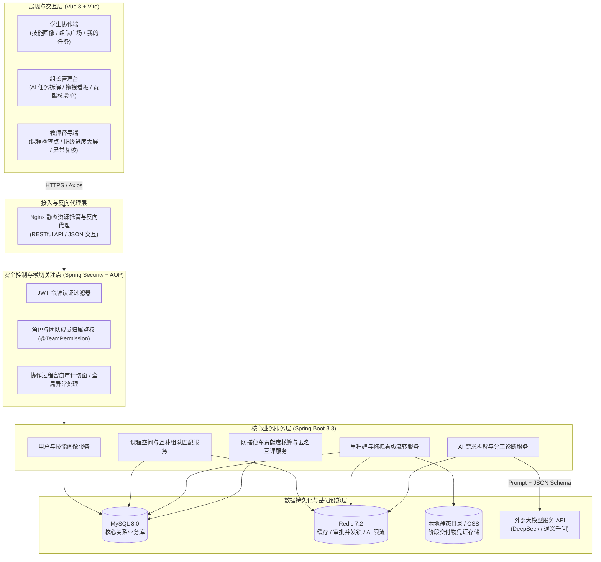
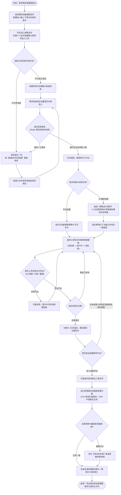
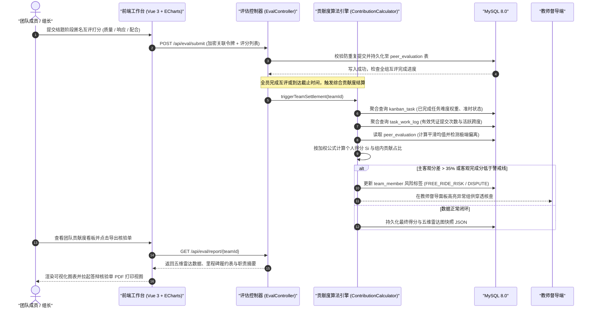
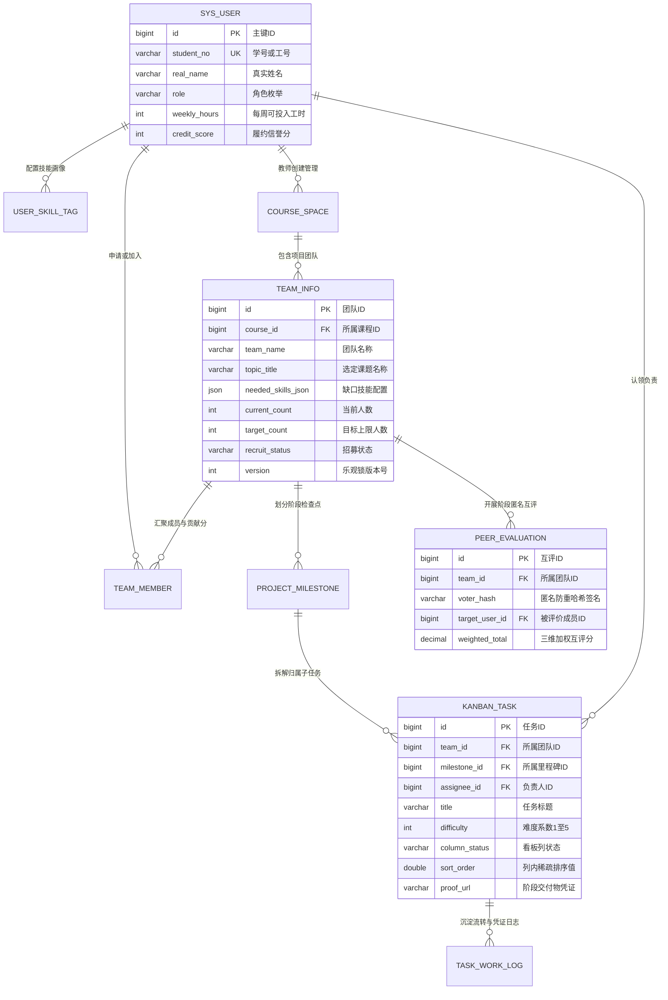

# 《课程设计选题设计文档》

| 项目条目 | 基本信息 |
| :--- | :--- |
| **课题名称** | **TeamPulse —— 大学生课程组队与防“搭便车”协作平台** |
| **课题副标题** | 基于 Spring Boot 3 + Vue 3 的高校课程项目互补组队、过程留痕与多维贡献度评估系统 |
| **完成形式** | 个人独立完成（计划开发周期：5 周） |
| **核心技术栈** | Vue 3 + Element Plus + ECharts + Spring Boot 3 + MyBatis-Plus + MySQL 8.0 + Redis 7.2 |
| **代码仓库地址** | https://github.com/Jiangsirui/web-course-design |
| **申报人姓名** | 蒋思睿 |
| **学号** | 2024337621116 |
| **专业班级** | 24软件工程1班 |

---

## 一、课题说明

### 1.1 选题背景

在高校计算机、软件工程及相关理工科专业的教学体系中，《Web 程序设计》《软件工程》《数据库系统课程设计》以及各类大学生创新创业与学科竞赛普遍采用**小组协作制（Project-Based Learning, PBL）**开展实践考核。

然而，在实际教学运行与学生协作过程中，传统的“微信/QQ 课程群刷屏招人 + 在线表格登记名单 + 期末口头汇报分工比例”模式长期存在显著痛点：
1. **组队阶段信息高度不对称**：学生倾向于优先与室友或熟人组队，极易出现“全组都会写后端、无人负责前端交互或文档答辩”的技能同质化现象；而跨专业选修或落单同学则难以在刷屏群聊中精准对接缺人队伍。
2. **项目推进过程缺乏透明留痕**：立项后缺乏清晰的阶段里程碑约束，群聊沟通记录碎片化，组长难以及时掌握组员真实进度，往往在答辩截止前两天才暴露出核心模块无人动工的风险。
3. **期末贡献度评估失真与“搭便车（Free-Riding）”现象频发**：少数成员在项目中期消极应付甚至全程“隐身”，期末却依靠熟人情面均享团队高分；承担超额工作量的核心成员缺乏客观过程数据自证，指导教师在期末集中答辩时也难以穿透表面演示核查每位成员的真实投入。

针对上述痛点，本课题拟设计并实现 **TeamPulse（大学生课程组队与防“搭便车”协作平台）**，通过“结构化技能互补匹配 + AI 辅助任务拆解 + 凭证化看板留痕 + 客观过程与匿名互评融合核算”，构建一套轻量、公平、适配高校课程实践全周期的 Web 协作系统。

### 1.2 目标用户与使用场景

#### （1）目标用户群体
系统面向高校实践教学中的三类核心角色：
- **普通学生（求组者 / 项目组员）**：维护个人技术栈标签与每周可投入工时；在组队广场筛选技能互补团队；认领看板任务、上传阶段性交付凭证（如 Git 提交链接、接口文档、页面截图等）、记录工作日志并参与阶段匿名互评。
- **团队负责人（学生组长）**：创建项目并发布缺口技能招募帖；利用内置 AI 助手解析课程任务书并生成里程碑与子任务；统筹看板流转、验收组员交付物、接收进度滞后预警，并在结题时一键导出《团队协作过程与贡献度核验报告》。
- **指导教师 / 助教（督导与评审端）**：创建课程班级空间、配置课程关键检查点（如选题申报、中期检查、结题答辩）及队伍人数上下限；通过红黄绿灯健康度面板宏观掌握全班各组推进情况，在期末评分时调阅各组的客观过程轨迹与贡献度雷达图作为差异化给分依据。

#### （2）典型使用场景
- **场景一：开课首周·跨班精准互补组队**  
  大三学生小张熟悉 `Spring Boot` 与 `MySQL`，但前端页面开发较弱。他在本课程空间发布“已有后端 1 人，招募熟悉 `Vue 3` 前端及 UI/文档搭档各 1 人”的招募卡；系统根据**技能短板互补算法**，将擅长 `Vue 3 + ECharts` 且每周空闲工时匹配的同班同学小李优先推荐至前列，双方在线互选确认后快速成团。
- **场景二：立项初期·AI 解析课程要求快速拆解分工**  
  成团后面对数千字的《课程设计要求书》，组长不知如何合理切分 5 周任务。组长将任务书原文粘贴至平台“AI 立项拆解助手”，系统自动解析出 4 个阶段里程碑及 14 张带难度系数与推荐角色的子任务卡片草稿，组长微调确认后一键导入团队看板。
- **场景三：研发中期·凭证化流转与低活跃风险预警**  
  组员将任务卡片从「进行中」拖入「待验收」时，系统强制要求附带至少一项交付凭证（代码 Commit URL、文档附件或实测截图），杜绝“空点完成”；若某成员超过 5 天无任何看板流转与工作日志记录，系统自动向组长与本人发送黄色滞后提醒。
- **场景四：结题答辩·多维贡献度核算与报告归档**  
  项目结题时，系统自动汇总各成员的加权任务完成分、准时交付率与有效协作日志，并开启组内双向匿名互评通道，最终生成每位成员的五维贡献度雷达图与可打印 PDF 核验单，直接附入课程设计报告作为平时分核定凭据。

### 1.3 拟解决的核心问题

1. **解决“盲目拉人、团队技能结构失衡”问题**：以结构化的「技能项 + 熟练度等级 + 期望承担角色 + 可投入工时」画像替代无序群聊，实现供需双向精准匹配。
2. **解决“协作过程黑盒、截止前突击返工”问题**：将阶段检查点与交付物强绑定，每一次状态流转均沉淀可回溯的时间戳与成果快照，让项目风险暴露在平时而非答辩前夜。
3. **解决“搭便车难界定、熟人当面不好意思给低分”问题**：建立以客观过程指标为主（占 70%）、加密匿名互评为辅（占 30%）的量化核算机制，用透明规则和数据图表消解人情压力。
4. **解决“学生初次独立统筹全栈项目缺乏拆解经验”问题**：借助大模型结构化拆解能力辅助生成颗粒度适中、前后端工时均衡的任务清单，降低项目管理门槛。

### 1.4 特色与创新点

1. **“客观过程留痕 + 匿名平滑互评”双驱动防搭便车模型**  
   不同于 Trello、飞书项目等面向企业的重型工具（缺乏学业互评与平时分核算逻辑），本系统专门针对课程设计场景构建了防刷分贡献度公式：结合**任务难度系数加权、强制交付凭证校验、准时率奖励及异常极端互评偏离度检测**，既防“浑水摸鱼搭便车”，也防“拆碎水任务刷分”与“恶意报复性低评”。
2. **面向团队短板补齐的“互补度评分”推荐机制**  
   区别于常规社交软件“越相似越匹配”的逻辑，平台设计了**技能互补度计算策略**：自动比对团队当前已有技能池与目标项目所需技能集合的差集，候选人越能填补团队高优先级技能空缺、且空闲时段重合度越高，匹配推荐分越高。
3. **业务原生嵌入式 AI 协同（而非生硬套壳聊天窗口）**  
   摒弃与业务割裂的通用聊天框，将大模型能力以**结构化 JSON 管道**形式无缝嵌入「课程任务书一键转看板卡片」与「期末个人分工述职摘要自动提炼」两个关键节点，AI 输出直接转化为前端可编辑、可落库的业务实体。
4. **答辩友好的可视化证据链与一键核验单**  
   基于 ECharts 构建「个人五维贡献雷达图」「团队里程碑燃尽趋势图」与「班级进度红黄绿灯矩阵」，支持一键渲染标准格式的《课程设计团队贡献度核验单》，直接服务于高校教师批改与答辩评审痛点。

---

## 二、项目框架

### 2.1 技术选型及理由

本项目采用主流企业级前后端分离架构，兼顾**工程规范性、5 周单人开发效率、可视化表现力与答辩稳定性**，具体选型与理由如下表所示：

| 技术分层 | 选型方案 | 选型核心理由 |
| :--- | :--- | :--- |
| **前端核心框架** | `Vue 3.4+` + `Vite 5` | 采用 Composition API（`<script setup>`）组织复杂看板与表单逻辑，代码内聚性高；Vite 毫秒级热更新显著提升单人全栈迭代效率。 |
| **UI 组件与拖拽交互** | `Element Plus` + `VueDraggablePlus` | Element Plus 提供完善的后台表格、抽屉、步骤条与表单验证组件；配合基于 SortableJS 的拖拽库可低成本实现流畅的四列看板拖拽流转。 |
| **数据可视化引擎** | `Apache ECharts 5` | 原生支持多维贡献雷达图、任务燃尽折线图、工时分布热力/柱状图，交互细腻且支持高清导出，高度契合本项目“量化防搭便车”的可视化呈现需求。 |
| **前端状态与路由** | `Pinia` + `Vue Router 4` + `Axios` | 轻量管理用户登录态、当前激活的课程/团队上下文；利用路由守卫与 Axios 拦截器统一处理 JWT 自动注入、权限菜单过滤及全局异常提示。 |
| **后端核心框架** | `Spring Boot 3.3`（`JDK 17 LTS`） | Java 企业级标准基座，自动配置完善、分层清晰，生态成熟稳定，便于通过 AOP 切面优雅实现项目成员归属权限校验与协作留痕审计。 |
| **持久层与 ORM** | `MyBatis-Plus 3.5` | 单表增删改查零 SQL 样板代码，内置分页与 `@Version` 乐观锁插件；同时保留原生 XML 编写多表关联聚合统计（贡献度多维计算）的灵活性。 |
| **认证与安全控制** | `Spring Security 6` + `JWT` | 无状态 Token 认证天然适配前后端分离架构，结合自定义方法级注解精准控制「学生 / 组长 / 指导教师」跨角色与跨团队的数据隔离安全。 |
| **关系型主数据库** | `MySQL 8.0`（InnoDB） | 强 ACID 事务保障组队审批、任务流转与互评提交的一致性；原生支持 `JSON` 字段与窗口函数，便于存储 AI 拆解草稿及高效计算组内贡献排名。 |
| **缓存与并发控制** | `Redis 7.2` | 缓存热门课程招募大厅列表与技能标签字典；使用分布式短锁防止最后 1 个队伍坑位并发超批，并基于计数器实现 AI 接口调用限流。 |
| **大模型能力集成** | `OpenAI 兼容 REST API`（DeepSeek / Qwen） | 通过后端 HTTP 客户端封装标准聊天补全接口，开启 `json_object` 结构化输出模式，轻量稳定、按量计费成本极低，无需本地 GPU 算力依赖。 |
| **API 文档与联调** | `Knife4j`（SpringDoc OpenAPI 3） | 基于注解自动生成交互式接口文档，单人开发时可直接在线调试后端接口并核对请求/响应结构，大幅减少前后端联调摩擦。 |

### 2.2 总体架构

系统在逻辑上划分为**展现交互层、接入网关层、安全与切面层、核心业务服务层、数据存储与外部集成层**五层架构：



### 2.3 前后端工程结构

项目采用仓库内前后端分目录（`teampulse-frontend` 与 `teampulse-backend`）的清晰工程组织方式，便于统一版本控制与独立构建运行：

```text
web-course-design/
├── 课程设计选题设计文档.md               # 选题设计申报文档
├── README.md                           # 项目导航说明
├── sql/
│   ├── init_schema.sql                 # 数据库建表 DDL 脚本（含索引与约束）
│   └── seed_demo_data.sql              # 答辩演示用模拟课程、团队与看板种子数据
├── teampulse-frontend/                 # 前端工程 (Vue 3 + Vite + Element Plus)
│   ├── public/
│   ├── src/
│   │   ├── api/                        # 按业务模块封装的 Axios 接口请求 (auth, team, kanban, eval, ai)
│   │   ├── assets/                     # 静态图标与全局样式变量
│   │   ├── components/
│   │   │   ├── kanban/                 # 拖拽看板列、任务卡片、交付凭证上传弹窗组件
│   │   │   ├── charts/                 # ECharts 贡献度雷达图、燃尽图、健康度指示器封装
│   │   │   └── ai/                     # AI 任务书解析预览与微调抽屉组件
│   │   ├── layout/                     # 顶部课程切换栏 + 侧边角色导航骨架布局
│   │   ├── router/                     # 路由表配置与登录/角色前置守卫
│   │   ├── stores/                     # Pinia 状态仓 (userStore, teamContextStore)
│   │   ├── utils/                      # 请求拦截器、日期格式化、PDF/打印导出工具
│   │   ├── views/
│   │   │   ├── auth/                   # 登录、注册与首次技能画像引导页
│   │   │   ├── square/                 # 课程组队招募大厅与互补推荐列表页
│   │   │   ├── workspace/              # 团队协作主工作台（里程碑、拖拽看板、过程时间轴）
│   │   │   ├── contribution/           # 阶段匿名互评页、贡献度明细看板与答辩核验单页
│   │   │   └── teacher/                # 教师课程管理、小组健康度监控与争议评分复核页
│   │   ├── App.vue
│   │   └── main.js
│   ├── index.html
│   ├── package.json
│   └── vite.config.js
└── teampulse-backend/                  # 后端工程 (Spring Boot 3 + MyBatis-Plus)
    ├── src/main/java/com/teampulse/
    │   ├── TeamPulseApplication.java   # Spring Boot 启动入口
    │   ├── common/                     # 统一返回体 Result<T>、业务异常类、常量枚举、分页封装
    │   ├── config/                     # Security 配置、Redis 配置、MyBatis-Plus 插件、跨域与 Knife4j 配置
    │   ├── security/                   # JWT 工具类、认证过滤器、团队成员越权校验切面
    │   ├── controller/                 # RESTful 控制器层 (Auth, Course, Team, Kanban, Eval, Ai, Teacher)
    │   ├── service/                    # 业务逻辑接口与实现层
    │   ├── algorithm/                  # 核心算法组件（技能互补匹配计算器、多维贡献度加权核算器）
    │   ├── ai/                         # 大模型 HTTP 客户端封装、Prompt 模板管理与 JSON 结构校验器
    │   ├── mapper/                     # MyBatis-Plus Mapper 接口
    │   └── model/
    │       ├── entity/                 # 与数据库表一一对应的持久化实体类
    │       ├── dto/                    # 前端入参接收与参数校验对象 (@Valid)
    │       └── vo/                     # 面向前端视图与图表渲染的聚合响应对象
    ├── src/main/resources/
    │   ├── mapper/                     # 复杂多表统计查询 XML 映射文件
    │   └── application.yml             # 多环境服务配置（数据源、Redis、JWT 密钥、AI 接口参数）
    └── pom.xml                         # Maven 依赖管理配置
```

### 2.4 开发与运行环境

| 环境类别 | 软件 / 组件名称 | 版本与规格说明 |
| :--- | :--- | :--- |
| **开发主机环境** | 操作系统 | Windows 11 64-bit |
| **编译与运行时** | Java 运行环境 / 前端运行时 | OpenJDK 17 LTS / Node.js 20.x LTS |
| **构建与包管理** | 后端构建 / 前端包管理 | Apache Maven 3.9+ / pnpm 9.x（或 npm 10.x） |
| **数据存储中间件** | 关系数据库 / 内存数据库 | MySQL 8.0.x（字符集 `utf8mb4`） / Redis 7.2.x |
| **集成开发工具** | IDE 与辅助调试工具 | Google Antigravity、IntelliJ IDEA 2024.x、Knife4j、Navicat、Git 2.50+ |
| **部署运行环境** | 服务端运行载体 | 本地双端联调运行，支持打包为可执行 JAR + Nginx 静态托管部署于 Linux (Ubuntu 22.04 / Docker) |
| **客户端访问要求** | 现代 Web 浏览器 | Chrome 120+、Microsoft Edge 120+、Firefox 等现代主流浏览器（分辨率建议 1366×768 及以上） |

---

## 三、功能模块设计

### 3.1 模块划分

系统围绕“组队前互补识人 → 组队中透明协作 → 结题时量化防搭便车”的业务主线，划分为 **6 大核心功能模块**：

```mermaid
flowchart TD
    Root["TeamPulse 大学生课程组队与防“搭便车”协作平台"]

    Root --> M1["1. 认证与技能画像模块"]
    Root --> M2["2. 课程空间与互补组队模块"]
    Root --> M3["3. AI 拆解与拖拽看板模块"]
    Root --> M4["4. 防搭便车评估与互评模块"]
    Root --> M5["5. 数据可视化与核验报告模块"]
    Root --> M6["6. 教师督导与系统管理模块"]

    M1 --> M1_1["账号注册登录与 JWT 鉴权"]
    M1 --> M1_2["技术栈标签与熟练度配置"]
    M1 --> M1_3["每周可投入工时与历史信誉档"]

    M2 --> M2_1["课程班级邀请码入驻"]
    M2 --> M2_2["项目立项与缺口角色招募"]
    M2 --> M2_3["技能互补度智能推荐排序"]
    M2 --> M2_4["入队申请与双选审批闭环"]

    M3 --> M3_1["AI 解析课程任务书生成草稿"]
    M3 --> M3_2["阶段里程碑与权重设定"]
    M3 --> M3_3["四列拖拽看板与优先级标记"]
    M3 --> M3_4["强制交付凭证校验与工作日志"]

    M4 --> M4_1["客观过程指标自动采集"]
    M4 --> M4_2["阶段双向匿名互评打分"]
    M4 --> M4_3["低活跃滞后预警检测"]
    M4 --> M4_4["加权贡献度平滑核算引擎"]

    M5 --> M5_1["个人五维贡献度雷达图"]
    M5 --> M5_2["团队任务燃尽与工时分布图"]
    M5 --> M5_3["答辩分工与贡献核验单导出"]

    M6 --> M6_1["课程空间与检查点规则配置"]
    M6 --> M6_2["全班各组进度红黄绿灯监控"]
    M6 --> M6_3["互评异常偏离争议复核"]
```



### 3.2 功能清单

为保障 5 周个人开发周期内核心闭环扎实落地，功能清单按优先级划分为 **P0（核心必做闭环）** 与 **P1（体验增强与答辩加分亮点）**：

| 所属模块 | 功能名称 | 适用角色 | 优先级 | 功能详细说明 |
| :--- | :--- | :--- | :---: | :--- |
| **认证与技能画像** | 用户注册登录与角色分配 | 全体用户 | P0 | 支持学号/工号注册登录，基于 BCrypt 加密存储密码并签发 JWT 令牌。 |
| **认证与技能画像** | 个人技能栈与工时画像 | 学生 | P0 | 选择掌握的技术标签（如 Vue 3、Java、UI 原型、答辩文档）、自评熟练度（1~5 星）及每周可投入小时数。 |
| **课程与互补组队** | 课程空间入驻 | 学生 / 教师 | P0 | 教师创建课程并生成 6 位课程码；学生凭课程码加入对应课程班级池。 |
| **课程与互补组队** | 发布组队招募帖 | 学生（组长） | P0 | 填写拟定课题方向、已具备技能、急缺角色标签及目标人数（受课程人数上下限约束）。 |
| **课程与互补组队** | 技能互补度匹配推荐 | 学生 | P0 | 自动计算当前登录学生技能与各招募帖“缺口技能 + 工时预期”的互补匹配分（0~100%），高亮匹配项。 |
| **课程与互补组队** | 入队申请与名额并发审批 | 学生 / 组长 | P0 | 求组者附言申请指定角色坑位；组长审批通过后自动更新成员列表，满员自动关闭招募。 |
| **AI 与拖拽看板** | AI 课程任务书一键拆解 | 组长 | P0 | 粘贴课程要求文本，调用大模型输出阶段里程碑及子任务树草稿（含建议角色与难度系数），确认后批量落库。 |
| **AI 与拖拽看板** | 阶段里程碑管理 | 组长 / 组员 | P0 | 划分项目阶段（如选题、原型、编码、联调、答辩），设置各阶段权重占比与截止日期。 |
| **AI 与拖拽看板** | 四列拖拽任务看板 | 组长 / 组员 | P0 | 支持任务卡在「待处理 → 进行中 → 待验收 → 已完成」四列间拖拽流转及列内排序。 |
| **AI 与拖拽看板** | 强制交付凭证提交与验收 | 组员 / 组长 | P0 | 任务移入「待验收」时强制校验提交说明与凭证（Commit 链接/截图/文档），由组长验收确认归档。 |
| **AI 与拖拽看板** | 过程协作日志时间轴 | 组长 / 组员 | P1 | 自动记录任务认领、状态流转、凭证提交与组长退回修改评论，形成完整不可篡改的项目时间轴。 |
| **防搭便车与互评** | 低活跃度与延期风险预警 | 系统自动 | P1 | 识别连续多日零操作或任务逾期未交付的成员，在团队工作台与教师督导端触发黄/红预警标记。 |
| **防搭便车与互评** | 阶段双向匿名互评 | 组长 / 组员 | P0 | 在里程碑或结题节点，组内成员围绕「任务质量、响应及时度、沟通配合度」对队友进行加密匿名打分。 |
| **防搭便车与互评** | 多维防搭便车贡献度核算 | 系统自动 | P0 | 融合客观完成权重分、准时率、过程日志活跃度与平滑处理后的匿名互评分，输出个人综合贡献分及团队占比。 |
| **可视化与核验报告** | 个人五维贡献度雷达图 | 全体角色 | P0 | 使用 ECharts 直观对比个人能力投入与组内均值（工作量、准时率、难度承担、协作频次、同伴认可）。 |
| **可视化与核验报告** | 团队进度燃尽与分工统计图 | 全体角色 | P1 | 动态展示剩余任务工时趋势与各成员承担工作量分布柱状图，直观评估分工均衡度。 |
| **可视化与核验报告** | 答辩分工与贡献核验单导出 | 组长 / 教师 | P0 | 一键生成结构化答辩核验页（含 AI 自动汇总的个人职责摘要与雷达图），支持浏览器原生打印导出 PDF。 |
| **教师督导管理** | 班级小组健康度监控大屏 | 指导教师 | P0 | 一屏总览全班成团率、未成团落单学生名单、各小组里程碑完成率及疑似“搭便车失衡”预警组。 |
| **教师督导管理** | 异常互评争议穿透核查 | 指导教师 | P1 | 当某成员主观互评得分与客观交付得分出现显著背离时自动标红，支持教师穿透查阅其历史交付凭证记录。 |

### 3.3 核心业务流程图

#### （1）课程组队至结题评估全生命周期流程图



#### （2）防“搭便车”贡献度核算与核验时序图



### 3.4 主要用例说明

#### 用例一：基于技能互补度的组队招募与申请审批（`UC-01`）

| 用例要素 | 详细规约说明 |
| :--- | :--- |
| **用例编号与名称** | `UC-01`：基于技能互补度的组队招募与申请审批 |
| **主要参与者** | 求组学生、项目组长 |
| **前置条件** | 双方均已登录系统并通过课程邀请码加入同一门课程空间，且求组学生尚未加入该课程下的其他队伍。 |
| **基本事件流** | 1. 求组学生进入课程“组队招募大厅”，系统读取其个人技能画像（标签集合、熟练度、每周可投入时长）。<br/>2. 系统遍历当前课程所有处于`招募中`状态的队伍，计算该学生对各队`缺口技能标签`的覆盖率及工时匹配度，按互补得分降序渲染卡片。<br/>3. 学生点击心仪队伍，选择拟认领的角色坑位（如“前端开发”），填写简短自荐说明并提交申请。<br/>4. 组长在工作台收到申请通知，查看申请人的技能雷达与历史课程履约信誉，点击「同意入队」。<br/>5. 系统通过锁机制核验当前队伍未超人数上限，将申请人状态置为`正式成员`，并将其技能并入团队已有技能池；若人数已达目标上限，自动将队伍招募状态置为`已成团`。 |
| **备选 / 异常事件流** | - **3a. 同一课程重复入队拦截**：若学生在此期间已被另一支队伍录取，系统自动撤回其余待审申请并拒绝重复入队。<br/>- **5a. 并发满员拦截**：若组长同时审批多人导致瞬间超出课程设定的人数上限，Redis 分布式锁与数据库乐观锁拦截后置请求，提示“团队名额已满”。 |
| **后置条件** | 团队成员关系正式建立，新成员自动获得该团队看板与里程碑的读写访问权限。 |

#### 用例二：AI 辅助解析课程要求并一键初始化任务看板（`UC-02`）

| 用例要素 | 详细规约说明 |
| :--- | :--- |
| **用例编号与名称** | `UC-02`：AI 辅助解析课程要求并初始化任务看板 |
| **主要参与者** | 项目组长、外部大模型服务 |
| **前置条件** | 团队已创建，组长拥有团队管理权限，且当前用户当日剩余 AI 调用配额大于 0。 |
| **基本事件流** | 1. 组长在团队工作台打开「AI 立项拆解助手」，粘贴教师发布的《课程设计要求》文本并设定项目总周数（如 5 周）及团队成员角色构成。<br/>2. 后端检查 Redis 限流配额后，组装系统级 Prompt（注入 JSON Schema 规范：要求输出阶段里程碑数组及对应的任务名称、建议角色、预估难度系数 `1~5`、验收交付物建议），请求大模型接口。<br/>3. 后端校验并解析大模型返回的 JSON 数据，返回给前端渲染在「可编辑拆解预览抽屉」中。<br/>4. 组长在预览界面增删任务、调整负责人指派及截止日期，点击「确认导入看板」。<br/>5. 系统开启数据库事务，批量写入 `project_milestone` 与 `kanban_task` 表，所有初始任务卡进入看板「待处理」列。 |
| **备选 / 异常事件流** | - **2a. 大模型响应超时或格式异常**：若超过 15 秒未响应或 JSON 解析校验失败，系统自动捕获异常并提示重试，同时提供内置「标准 Web 全栈课设五阶段模板」供组长一键套用，保证主流程不阻塞。 |
| **后置条件** | 项目阶段里程碑与初始任务看板创建完毕，组员可在各自工作台看到待认领或已指派的任务卡。 |

#### 用例三：凭证化任务流转与过程留痕（`UC-03`）

| 用例要素 | 详细规约说明 |
| :--- | :--- |
| **用例编号与名称** | `UC-03`：凭证化任务流转与过程留痕 |
| **主要参与者** | 项目组员、项目组长 |
| **前置条件** | 团队看板中存在已指派给该组员的任务卡片。 |
| **基本事件流** | 1. 组员开始编码或撰写文档时，将看板卡片从「待处理」拖入「进行中」，系统自动记录实际开始时间。<br/>2. 阶段工作完成后，组员将卡片拖向「待验收」列，前端自动弹出「阶段成果交付凭证」表单。<br/>3. 组员填写本次完成摘要、实际投入工时，并至少提交一项可核验凭证（Git Commit/PR 链接、在线文档地址或成果截图附件）。<br/>4. 组长在「待验收」列点击核验凭证，确认符合预期后点击「验收通过」，卡片流转至「已完成」列，系统写入不可篡改的 `task_work_log` 过程日志。 |
| **备选 / 异常事件流** | - **3a. 无凭证空转拦截**：若组员未填写任何凭证链接或附件即尝试移入「待验收/已完成」，前后端双重校验拒绝状态变更，防止“口头完成”刷分。<br/>- **4a. 验收打回修改**：若交付物不达标，组长填写修改意见打回至「进行中」，留痕记录打回原因。 |
| **后置条件** | 任务状态更新为已完成，对应难度积分与准时履约状态纳入该成员的客观过程统计池。 |

#### 用例四：阶段匿名互评与防“搭便车”贡献度综合核算（`UC-04`）

| 用例要素 | 详细规约说明 |
| :--- | :--- |
| **用例编号与名称** | `UC-04`：阶段匿名互评与防“搭便车”贡献度综合核算 |
| **主要参与者** | 全体团队成员、指导教师（异常复核） |
| **前置条件** | 项目进入结题考核阶段（或关键中期里程碑节点），团队成员人数 ≥ 2。 |
| **基本事件流** | 1. 组长或课程检查点触发结题评估，系统向全组开放匿名互评表单。<br/>2. 每位成员对其余队友在「交付质量（40%）」「响应及时性（30%）」「沟通协作度（30%）」三个维度打分（百分制），后端以单向哈希摘要校验“每人仅评一次”且对组长和队友隐藏打分人身份。<br/>3. 系统采集全组客观过程数据与互评数据，按以下加权模型核算成员 $i$ 的综合贡献得分 $S_i$（满分 100）：<br/>$$S_i = 0.45 \times T_i + 0.15 \times O_i + 0.10 \times A_i + 0.30 \times P_i$$<br/>其中：$T_i$ 为基于组内任务难度系数与里程碑权重归一化的**加权任务完成分**；$O_i$ 为本人负责任务的**按时交付率得分**；$A_i$ 为有效工作日志与凭证提交跨度的**过程持续活跃分**；$P_i$ 为平滑修正后的**组内匿名互评均分**。<br/>4. 系统进一步计算每位成员的团队贡献占比 $R_i = S_i / \sum_{k=1}^{n} S_k$，生成五维贡献雷达图与《答辩分工核验单》。 |
| **备选 / 异常事件流** | - **3a. 搭便车低贡献识别**：若某成员客观加权任务分 $T_i$ 低于全组均值的 35%，系统自动标记为`疑似搭便车低投入`。<br/>- **3b. 恶意报复性互评检测**：当团队人数 ≥ 4 时，$P_i$ 自动剔除极端异常离群值；若 $|T_i - P_i| > 35$，系统标记`主客观评分背离`并推送指导教师端穿透查阅原始凭证。 |
| **后置条件** | 团队贡献度核算快照归档锁定，可供组长打印附入课程设计报告，或供教师端直接查阅评定平时成绩。 |

---

## 四、数据库选型

### 4.1 存储组件选型与理由

本项目采用 **MySQL 8.0（关系型主存储） + Redis 7.2（高性能内存键值存储）** 的组合方案：

1. **主数据库选用 MySQL 8.0（InnoDB 引擎）的核心理由**：
   - **强关系约束与事务保障**：用户、课程空间、团队、里程碑、看板任务、工作日志与互评记录之间具有严密的一对多、多对多关联关系；入队审批扣减名额、AI 任务树批量入库、结题贡献度结算均依赖 InnoDB 的行级锁与 ACID 事务保障数据零错乱。
   - **原生 `JSON` 类型与函数支持**：针对“AI 拆解预览草稿”“结题五维雷达图快照”“技能扩展属性”等半结构化数据，MySQL 8.0 原生 `JSON` 类型可在保持核心表范式整洁的前提下避免冗余扩展表。
   - **成熟的聚合统计能力**：支持 CTE（公用表表达式）与窗口函数（如 `RANK() OVER`），非常适合在服务端高效聚合计算班级内各小组进度百分位与组内贡献度排名。
2. **辅助数据组件选用 Redis 7.2 的核心理由**：
   - **高并发名额互斥控制**：针对组长审批最后 1 个入队坑位、或成员争抢认领同一张高分公共任务卡的瞬时并发场景，使用 `SET key value NX PX` 短时分布式锁低成本消除竞态冲突。
   - **热点读缓存与字典加速**：缓存高频访问的课程组队广场列表与标准技能标签树，响应延迟控制在毫秒级。
   - **安全会话与 AI 配额限流**：维护 JWT 主动注销黑名单，并利用原子自增 `INCR + EXPIRE` 限制单用户每日调用大模型拆解接口的次数，防止接口滥用。

### 4.2 同类数据库对比分析

| 对比维度 | **MySQL 8.0 + Redis 7.2（本项目选用）** | PostgreSQL | MongoDB（文档数据库） | SQLite（嵌入式数据库） |
| :--- | :--- | :--- | :--- | :--- |
| **事务与关系表达** | 强 ACID 事务，外键与关联聚合极成熟 | 强 ACID，复杂空间/数组类型丰富 | 多文档事务较重，不擅长多表复杂关联统计 | 库级写锁，多用户并发写入性能受限 |
| **半结构化扩展** | 原生支持二进制 `JSON` 存储与索引 | 原生 `JSONB` 极强 | 天然 BSON 文档模型 | 仅作为普通文本解析 |
| **并发锁与限流支撑** | Redis 原生原子指令完美支撑锁与限流 | 需借助咨询锁或额外引入 Redis | 缺乏轻量级内存过期计数器生态 | 不适合分布式/高并发锁场景 |
| **生态契合与部署成本** | 与 Spring Boot 3 + MyBatis-Plus 契合度最高，运维资料极丰富 | 国内高校课设环境配置相对略少 | 业务强关系被弱化，易产生数据冗余不一致 | 仅适合单机玩具应用，不符合企业级 Web 架构标准 |

### 4.3 核心数据表规划与实体关系设计（ER 图）

数据库共规划 **9 张核心业务表**，兼顾第三范式（3NF）规范性与统计查询效率：

| 序号 | 表名 | 中文名称 | 核心字段与设计职责说明 |
| :---: | :--- | :--- | :--- |
| 1 | `sys_user` | 用户基础信息表 | `id`, `student_no`（学号/工号唯一索引）, `username`, `password_hash`, `real_name`, `role`（STUDENT/TEACHER/ADMIN）, `weekly_hours`（每周可投入工时）, `credit_score`（历史履约信誉分） |
| 2 | `user_skill_tag` | 用户技能画像表 | `id`, `user_id`, `skill_code`（如 `VUE3`, `SPRING_BOOT`, `UI_DOC`）, `proficiency`（熟练度 1~5）, `prefer_role`（期望承担角色） |
| 3 | `course_space` | 课程班级空间表 | `id`, `course_name`, `invite_code`（6 位唯一邀请码）, `teacher_id`, `min_members`, `max_members`, `checkpoint_json`（阶段检查点配置）, `status` |
| 4 | `team_info` | 项目团队招募表 | `id`, `course_id`, `team_name`, `topic_title`, `topic_desc`, `leader_id`, `needed_skills_json`（急缺技能标签与人数）, `current_count`, `target_count`, `recruit_status`, `version`（乐观锁） |
| 5 | `team_member` | 团队成员与贡献表 | `id`, `team_id`, `user_id`, `member_role`（LEADER/MEMBER）, `duty_tag`（具体分工角色）, `join_status`（PENDING/JOINED/REJECTED）, `final_score`（`DECIMAL(5,2)` 综合贡献分）, `contrib_ratio`, `risk_flag` |
| 6 | `project_milestone` | 项目阶段里程碑表 | `id`, `team_id`, `title`, `weight_percent`（阶段权重占比）, `due_date`, `status`, `sort_order` |
| 7 | `kanban_task` | 看板任务卡片表 | `id`, `team_id`, `milestone_id`, `assignee_id`, `title`, `description`, `difficulty`（难度系数 1~5）, `column_status`（TODO/DOING/REVIEW/DONE）, `sort_order`（稀疏浮点排序值）, `proof_url`（交付凭证链接）, `due_time`, `completed_at` |
| 8 | `task_work_log` | 过程留痕工作日志表 | `id`, `task_id`, `team_id`, `operator_id`, `action_type`（CLAIM/MOVE/SUBMIT_PROOF/REJECT/APPROVE）, `from_status`, `to_status`, `spent_hours`, `proof_snapshot`, `comment`, `created_at` |
| 9 | `peer_evaluation` | 阶段匿名互评记录表 | `id`, `team_id`, `milestone_stage`, `voter_hash`（评价人单向防重签名）, `target_user_id`, `quality_score`, `timeliness_score`, `collab_score`, `weighted_total`, `created_at` |



---

## 五、开发计划

### 5.1 阶段计划（5 周个人敏捷迭代排期）

结合个人独立完成与 5 周（35 天）的标准课程设计周期，采用**“核心骨架先行 → 业务主干迭代 → 量化算法与 AI 赋能 → 联调打磨”**的渐进式计划：

| 迭代阶段 | 时间跨度 | 阶段核心目标 | 具体研发任务拆解 | 阶段里程碑交付物 |
| :--- | :---: | :--- | :--- | :--- |
| **第一阶段：需求建模与基础底座搭建** | **第 1 周** | 打通前后端工程骨架、安全认证与个人技能画像 | 1. 完成选题设计文档定稿及 9 张核心表 `init_schema.sql` 建表；<br/>2. 初始化 Spring Boot 3 + MyBatis-Plus + Redis 后端骨架与统一返回/异常体系；<br/>3. 初始化 Vue 3 + Vite + Element Plus 前端骨架、路由守卫与请求封装；<br/>4. 实现注册登录（JWT）及个人技能栈画像配置页。 | 可运行的前后端基础工程、数据库脚本、登录与技能画像模块 |
| **第二阶段：课程空间与互补组队闭环** | **第 2 周** | 完成从课程入驻到智能互补匹配成团的全流程 | 1. 实现教师创建课程空间、6 位邀请码生成与学生入驻逻辑；<br/>2. 开发组队招募帖发布、多条件筛选广场；<br/>3. 编码实现**技能互补度评分排序器**，高亮展示申请人与缺口技能的匹配明细；<br/>4. 实现入队申请、组长双选审批及 Redis + 乐观锁并发满员控制。 | 组队招募广场、互补匹配推荐功能、双选入队闭环 |
| **第三阶段：拖拽协作看板与 AI 拆解集成** | **第 3 周** | 打通项目过程留痕看板与大模型任务书解析 | 1. 开发阶段里程碑 CRUD 与权重校验（总和 100%）；<br/>2. 基于 `VueDraggablePlus` 实现四列拖拽任务看板及列内稀疏排序；<br/>3. 实现「待验收」强制交付凭证表单、组长验收/打回流转与 `task_work_log` 时间轴；<br/>4. 接入 DeepSeek / 通义千问 API，实现《课程设计要求》一键拆解预览与批量导入。 | 四列可拖拽看板、凭证化留痕时间轴、AI 立项任务拆解助手 |
| **第四阶段：防搭便车算法、互评与可视化** | **第 4 周** | 落地核心贡献度评估引擎、图表大屏与教师督导端 | 1. 实现加密防重匿名互评通道（质量/响应/配合三维打分）；<br/>2. 编码实现**防搭便车多维贡献度核算引擎**及主客观分差异常检测、低活跃预警；<br/>3. 基于 ECharts 集成个人五维贡献雷达图、团队燃尽图及《答辩分工核验单》打印导出；<br/>4. 完成教师端班级小组红黄绿灯监控面板与异常组穿透审查页。 | 贡献度核算引擎、ECharts 可视化看板、可打印核验单、教师督导台 |
| **第五阶段：测试优化、数据预置与答辩准备** | **第 5 周** | 全链路联调排错、异常压测与答辩演示打磨 | 1. 编写贡献度计算边界单元测试（全勤核心、零提交搭便车、恶意互评等场景）；<br/>2. 校验跨团队接口越权防护（IDOR 漏洞检查）与 AI 接口超时降级兜底；<br/>3. 编写一套真实感强的模拟班级与多团队全周期种子数据（`seed_demo_data.sql`）；<br/>4. 整理完整源码注释、部署文档、结题报告与答辩演示脚本。 | 完整可演示系统、测试验证记录、课程设计总结报告与答辩材料 |

### 5.2 难点预估与工程解决方案

| 序号 | 核心技术/业务难点预估 | 潜在问题表现 | 拟采取的工程解决方案 |
| :---: | :--- | :--- | :--- |
| **1** | **贡献度量化模型的公平性与防刷分博弈** | 若单纯统计完成任务个数，易出现成员故意将简单工作拆成十几个碎卡片“刷量”；或在匿名互评中因私人矛盾恶意打超低分。 | 1. **难度与阶段双加权**：任务得分绑定组长审定的难度系数（1~5）与里程碑权重，且移入完成态必须附带非空交付凭证并经组长验收；<br/>2. **截尾平滑与偏离预警**：4 人及以上团队互评自动削弱极端离群值权重，当主观互评分与客观交付分偏差超过 35% 时自动触发教师复核标记。 |
| **2** | **大模型返回结构的不确定性与响应延迟** | LLM 可能在 JSON 外包裹多余解释文本、字段缺失，或生成耗时 4~8 秒导致用户重复点击甚至前端超时断开。 | 1. **强 Schema 约束**：启用 API 的 `response_format: { "type": "json_object" }` 并在后端设计正则清洗与 Jackson 容错校验层；<br/>2. **草稿预览交互 + 模板兜底**：前端提供骨架屏加载反馈与防抖锁，AI 结果先进入前端可编辑草稿抽屉确认后再落库；若接口超时失败，无缝切换内置标准课设模板。 |
| **3** | **拖拽看板高频重排的写放大与顺序错乱** | 用户在看板列内频繁上下拖拽调整卡片优先级时，若每次重排都批量更新整列数十条数据的序号，会导致频繁锁表与无效 SQL。 | 采用**稀疏双精度间隔排序法（步长 `65536.0`）**：将卡片插入位置前后相邻两张卡的 `sort_order` 取算术平均值 `(prev + next) / 2`，单次拖拽仅需执行 1 条 `UPDATE` 语句；仅当精度间距小于阈值时触发后台列内重平衡。 |
| **4** | **多团队数据隔离与越权访问风险（IDOR）** | 学生通过篡改 URL 或请求体中的 `teamId` / `taskId`，可能非法窥探其他小组的任务凭证或修改非本人团队看板。 | 自定义 Spring AOP 权限注解 `@CheckTeamMember(role = ...)`：在进入业务 Service 前统一从 SecurityContext 提取当前 `userId`，结合缓存校验其与目标 `teamId` 的真实归属与组长/教师角色权限，从切面层根绝水平越权。 |

---

## 六、AI工具使用计划

在本课题从立项设计到编码交付的全生命周期中，将遵循**“AI 提效赋能、人工掌控架构与质量边界”**的原则，分阶段、有针对性地引入 AI 工具辅助工程研发。

### 6.1 拟使用的 AI 工具矩阵

| 工具名称 | 工具类型与定位 | 拟介入的研发阶段 |
| :--- | :--- | :--- |
| **Google Antigravity** | 智能体全栈研发环境（Agentic IDE） | 需求梳理、架构设计、前后端工程脚手架生成、跨文件代码重构、接口联调与自动化排错 |
| **DeepSeek / Claude / ChatGPT** | 通用高阶推理与算法推演助手 | 互补匹配公式与防搭便车加权模型的边界数学验证、复杂统计 SQL 优化、极端异常测试用例构造 |
| **DeepSeek-V3 / 通义千问 API** | 系统运行时业务内嵌大模型服务 | 作为平台后端 `AISvc` 的底层推理接口，驱动“课程任务书智能拆解”与“答辩个人分工摘要提炼” |
| **Apifox AI / Knife4j 辅助** | 接口契约与 Mock 测试辅助工具 | 根据 DTO 注释快速生成逼真的模拟测试入参及边界校验用例 |

### 6.2 各研发环节的具体使用方案与预期效果

1. **需求分析与系统设计环节**
   - **使用方式**：借助 Antigravity 与推理大模型开展头脑风暴，推演高校课设真实痛点，审视业务流程图闭环漏洞，辅助绘制标准化 Mermaid 架构图、时序图与 ER 实体关系图。
   - **预期效果**：需求论证与文档结构化撰写效率提升约 **50%**，在动工编码前提前规避状态流转死胡同（如满员并发冲突、无凭证空点完成等边界遗漏）。
2. **数据库建模与前后端接口契约对齐环节**
   - **使用方式**：基于实体设计快速生成带完整中文注释、外键逻辑索引与默认值的 MySQL 8.0 DDL 脚本；同步由后端 Java `VO/DTO` 自动映射生成前端一致的接口调用封装与演示用高拟真种子数据脚本（模拟 1 个 40 人班级、8 支不同状态队伍的完整协作轨迹）。
   - **预期效果**：消除前后端字段命名不一致引发的低级联调 Bug，测试演示数据构建耗时缩短 **70%** 以上。
3. **前后端核心编码与可视化开发环节**
   - **使用方式**：利用 AI 快速生成 MyBatis-Plus 基础样板层、Element Plus 复杂表单验证规则，以及 ECharts 五维雷达图与燃尽图的视觉配色、响应式缩放配置项；将个人核心精力集中投入在**互补匹配算法、防搭便车加权核算、AOP 越权防护及拖拽交互体验**上。
   - **预期效果**：重复性样板代码编写时间减少约 **60%**，确保单人在 5 周周期内高质量交付完整闭环而非半成品。
4. **单元测试、边界排错与代码审查环节**
   - **使用方式**：针对 `ContributionCalculator`（贡献度核算器）与 `SkillMatchCalculator`（互补匹配器），辅助编写 JUnit 5 参数化单元测试集（覆盖全勤组长、正常组员、零提交搭便车者、全员互打满分/低分等极端输入）；在联调遇到跨域、JWT 过滤器链顺序或异步异常时辅助快速定位根因。
   - **预期效果**：核心业务算法分支覆盖率达到 **90%** 以上，显著降低答辩现场演示翻车概率。

### 6.3 AI 工具使用边界与工程质量管控原则

为避免过度依赖 AI 导致“代码黑盒化”或引入安全隐患，本项目严格执行以下三条人工把控准则：
1. **架构与业务规则自主决策**：核心数据库表关系、权限控制矩阵及贡献度计算权重均由本人结合课程实际逻辑独立审定，不盲目照搬 AI 默认生成的泛化模板。
2. **逐行审查与实测闭环（Human-in-the-Loop）**：凡由 AI 辅助生成的代码片段（尤其是涉及 SQL 聚合统计、并发锁与安全鉴权逻辑），必须经本人逐行阅读理解、补充边界判空并通过本地联调实测后方可提交入库。
3. **敏感配置与隐私脱敏保护**：开发与提交 Git 仓库过程中，严格通过环境变量（`.env` / `application-local.yml`）隔离数据库密码、JWT 密钥与大模型 API Key，杜绝硬编码敏感凭据上传至公开代码仓库。
